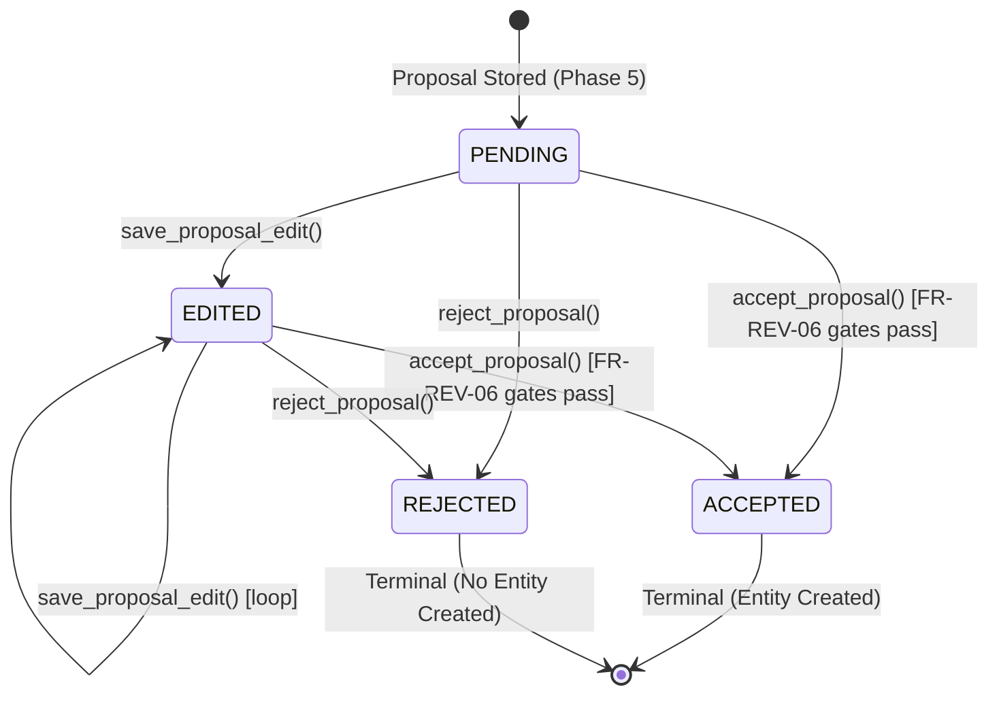

# ASEC Phase 6 Plan — Proposal Review Service

Status: amended 2026-10-26 with the owner-approved decisions below and authorized as
one implementation batch (internal workstreams). Derived from `docs/SRS.md` (requirements
authority), `AGENTS.md` (workflow, architecture and safety rules), `docs/ASEC_Context_Prompt.md`,
`docs/DECISIONS.md` (owner's approved decision log, section A), and the actual repository state
verified at session start (§1). Storage existence never implies behavior is implemented;
tests-first and the slice workflow of `AGENTS.md` apply to every step below.

---

## 1. Verified baseline (2026-10-26 session-start check, read-only)

- Branch `main`; HEAD `d83511d` — "Beginning of phase 6" (owner commit, Mon
  26 Oct 2026 09:14 IST). This commit adds **only three docs files**
  (`docs/DECISIONS.md` +44, `docs/PHASE6_PLAN.md` +609, `docs/SRS_figures_digest.md` +23;
  676 insertions, 0 code changes — verified with `git diff 7e0d77c d83511d --stat`),
  so the Phase 5 code baseline is byte-identical to the previously expected
  HEAD `7e0d77c`, which remains this plan's parent commit. The owner was asked at
  session start and authorized proceeding from `d83511d`. Working tree clean;
  nothing staged.
- Commands run this session and their real, observed results:
  - `git log --oneline -n 3`: `d83511d / 7e0d77c / ab94b40` (as above).
  - `git status --short`: empty (clean; `docs/PHASE6_PLAN.md` is committed, not
    untracked).
  - `.venv\Scripts\python.exe -m pytest` (plain; `pyproject.toml` sets `-q`):
    **877 passed in 169.25s (0:02:49)** — 0 failures, 0 errors, 0 skips.
  - `.venv\Scripts\python.exe -m ruff check .`: **All checks passed!**
  - `.venv\Scripts\python.exe -m mypy`: **Success: no issues found in 13 source files**.
- `python -m backend --version`, the fresh-database migration probe and
  `git diff --check` were not re-run at session start (they are part of
  the Step-4 final battery below and were green at the 2026-10-25 baseline
  check); the plan's Step-4 battery owns a fresh, complete re-run.
- **Continuation-session re-check (2026-10-26, real output):** HEAD is still
  `d83511d`; the working tree has the amended `docs/PHASE6_PLAN.md`, the count
  bump in `tests/test_migrations_resolution.py`, the A12-repaired schema test
  file `tests/test_migrations_review_revisions.py`, and — carried over from the
  interrupted session — untracked `backend/db/migrations/0015_review_revisions.sql`
  and `backend/review.py`. Those two implementation files had **no service test
  suite** at resumption and the WS-P5 hook was **not** wired. The 0015 schema
  tests and the migration-count test now pass (`48 passed`), `ruff check .` is
  clean and `mypy` is clean (14 source files). A12 is therefore recorded as
  already satisfied by the repaired harness; the remaining RED evidence for the
  review service comes from the new `tests/test_review_service.py` and the
  mutation checks in §9/§15.
- Source of diagrams:
  - File `docs/SRS_figures_digest.md` **now exists** (the owner's commit
    `d83511d` added it) and transcribes Figures 6–9 normative content;
    per its own header the DOCX governs if they disagree. Figure 6
    ("Proposal review states"): pending → edited (loops) → accepted or
    rejected; accepted and rejected are terminal; accept blocked while an
    assignee is unresolved or flagged; AH-raised cross-vertical task starts
    PENDING and hidden (Figure 8).

---

## 2. Phase 6 authoritative scope (from `docs/SRS.md`)

Phase 6 implements the **proposal review service** and notification staging hook:

- **FR-REV-01**: Review states are `PENDING`, `EDITED`, `ACCEPTED`, and `REJECTED`.
  `EDITED` is not final (can loop back to `EDITED` through subsequent edits).
  Accepting an edited proposal creates an entity from the latest edited values.
- **FR-REV-02**: The reviewer of a proposal is the sender of its primary source message
  (`proposal.primary_message_id -> source_message.sender_person_id`). Only the reviewer
  (and Admin) can review it. The review service provides a presentation view containing:
  the proposal draft, its source message with context (sender, group, timestamp, replies),
  and the provenance of each value.
- **FR-REV-03**: The reviewer shall be able to edit editable fields: description,
  assignment mode (`EXPLICIT`, `OPEN`, `NONE`), assignees, people needed (specific count or
  unlimited), task type (`INTERNAL`, `CROSS_VERTICAL`), responsible vertical, affected verticals,
  and attributes. Each edit creates an immutable `proposal_revision` recording who changed what
  and when (`changed_fields`, `person_id`, `changed_at`). The original generated row in
  `proposal` stays unchanged. (Whether `ptype` is editable is owner decision OD-REV-4).
- **FR-REV-04**: Saving an edit shall not accept the proposal. Edit and accept are separate
  actions, although client flows may present them consecutively.
- **FR-REV-05**: Accepting shall create exactly one task or announcement. Two simultaneous
  accepts, or a repeated accept, shall produce exactly one entity (idempotent/concurrency-safe).
- **FR-REV-06**: Accepting shall be blocked while any proposed assignee is `UNRESOLVED` or
  `FLAGGED`, or a required field is unfilled. For an `OPEN` task, `people_needed` shall be a
  positive integer or `UNLIMITED`.
- **FR-REV-07**: Rejecting shall record a `proposal_decision` row (`decision = 'REJECTED'`,
  optional note, timestamp, actor) and transition `review_state` to `REJECTED`. The proposal,
  its revisions, and the rejection record are kept. A rejected proposal is never regenerated
  or reconsidered automatically.
- **FR-REV-08**: Rejected and edited proposals shall be usable as labelled evaluation data
  (queryable with full revision history and delta against generated drafts).
- **FR-REV-09**: For each proposal the system shall record which fields the reviewer changed
  (`proposal_revision.changed_fields`).
- **FR-REV-10**: An accepted `ANNOUNCEMENT` proposal shall create an announcement record
  targeted to its audience (a Head’s vertical, or the sender AH’s volunteers) and shall
  **not** create a task.
- **FR-PRP-17**: When a valid proposal is stored, the backend shall notify its reviewer,
  and no one else. (Review phase delivers the authoritative proposal-ready notification hook).
- **FR-AUT-01 / Matrix**: Proposal review/edit/accept/reject is authorized strictly for
  the primary message sender (AH/Head) or Admin override. Unauthorized calls fail loud and
  raise `ReviewAuthorizationError` before any state mutation.
- Acceptance criteria from SRS §10.2:
  - **AC-04**: Proposal rejection with optional note.
  - **AC-05**: Proposal edit creates immutable revision; proposal row values stay unchanged.
  - **AC-06**: Acceptance blocked while any assignee is unresolved or flagged.
  - **AC-07**: Acceptance of TASK creates task and records decision.
  - **AC-18**: Acceptance of ANNOUNCEMENT creates announcement record and no task.

### Explicit non-goals (standing boundaries; out of Phase 6):
1. **Task volunteer lifecycle (Phase 7)**: Volunteer task claiming (`FR-TSK-04`),
   agreement transitions (`AWAITING -> ACCEPTED / DENIED`, `FR-TSK-05`), volunteer work status
   transitions (`NOT_STARTED -> IN_PROGRESS -> COMPLETED`, `FR-TSK-06`), task cancellation
   (`FR-TSK-08`), and post-creation editing/reassignment (`FR-TSK-16`).
2. **Cross-vertical approval decision voting (Phase 8)**: Processing approval or denial decisions
   from target vertical AHs/Head (`FR-XV-04..06`). Phase 6 stages the request and initial state
   dimensions upon acceptance, but does not implement the approval voting service.
3. **External notification delivery transport (Phase 9)**: FCM push dispatch, SMS OTP,
   network transport, delivery worker loops (`FR-NOT-06..07`). Phase 6 writes notification rows
   in `0008` storage only.
4. **HTTP / REST / GraphQL API & Mobile App UI (Phase 10)**: FastAPIs, JWT authentication,
   and mobile screens (`FR-UI-*`). Phase 6 delivers pure Python backend services and domain functions.
5. **Direct Discord mutations**: Discord is read-only source; no Discord messages or bot posts.

---

## 3. Established storage and code to reuse (no rebuild)

Already migrated and available in SQLite:
- `0001_core_roster.sql`: `person` (active, role, `discord_user_id`), `vertical`, `person_vertical`.
- `0002_source_messages.sql`: `source_message` (`sender_person_id`, `event_timestamp`, content).
- `0003_buckets.sql`: `bucket`, `bucket_message`.
- `0004_processing_attempts.sql`: `processing_attempt`.
- `0005_proposals.sql`:
  - `proposal` table (`review_state` with CHECK `IN ('PENDING', 'EDITED', 'ACCEPTED', 'REJECTED')`,
    ptype, assignment_mode, people_needed, task_type, verticals, provenance).
  - `proposal_revision` table (`proposal_id`, `revision_number`, `person_id`, `changed_fields`,
    `changed_at`, snapshot content fields, `UNIQUE(proposal_id, revision_number)`).
  - `revision_attribute` table (`revision_id`, `attr_key`, `attr_value`).
  - `revision_affected_vertical` table (`revision_id`, `vertical_id`).
  - `proposal_context_message` table.
- `0006_tasks.sql`:
  - `task` table (`proposal_id UNIQUE`, `task_type`, `source_vertical_id`, `responsible_vertical_id`,
    `creator_id`, `description`, `assignment_mode`, `people_needed`, `people_needed_unlimited`,
    `approval_state`, `cancellation`, `version`, `created_at`).
  - `task_assignee` table (`task_id`, `person_id`, `agreement`, `agreed_at`, `work_status`,
    `cancelled`, `added_at`, `UNIQUE(task_id, person_id)`).
  - `task_history` table (`task_id`, `field_name`, `old_value`, `new_value`, `changed_at`,
    `actor_person_id`, `actor_role`, `actor_vertical_id`, `reason`).
  - `task_attribute` table (`task_id`, `attr_key`, `attr_value`, `UNIQUE(task_id, attr_key)`).
  - `task_affected_vertical` table (`task_id`, `vertical_id`, `UNIQUE(task_id, vertical_id)`).
- `0007_cross_vertical_approvals.sql`:
  - `approval_request` table (`task_id UNIQUE`, `requested_by`, `request_message`, `created_at`).
  - `approval_recipient` table (`request_id`, `person_id`, `UNIQUE(request_id, person_id)`).
  - `approval_decision` table (`request_id UNIQUE`).
- `0008_notifications.sql`: `notification` table (`dedupe_key UNIQUE`, `event_type`, `recipient_person_id`,
  `proposal_id`, `task_id`, `delivery_state`, `created_at`).
- `0009_announcements.sql`: `announcement` table (`proposal_id UNIQUE`, `accepted_by`, `accepted_at`,
  `audience_vertical_id`, `audience_scope`).
- `0012_resolution_and_mentions.sql`:
  - `proposal_decision` table (`proposal_id UNIQUE`, `decision IN ('ACCEPTED', 'REJECTED')`,
    `decided_by`, `decided_at`, `note`).
  - `proposal_assignee` table (`proposal_id`, `assignee_text`, `resolution IN ('RESOLVED', 'UNRESOLVED', 'FLAGGED')`,
    `person_id`, `resolved_via IN ('MENTION', 'NAME_MATCH')`).
  - `message_mention` table.
- `0014_proposal_attempt_input.sql`: `proposal_attempt_input`.

Existing backend modules to consume:
- `backend/db/connection.py`: `connect()`, `transaction(connection)` (`BEGIN IMMEDIATE`).
- `backend/proposals.py`: types, resolution routines, policy checks.
- `backend/masking.py`: PII masking.

---

## 4. Architecture and State Machine (Figure 6)

### 4.1 State Machine Specification



1. **PENDING**: Initial state upon generation by Phase 5 (`review_state = 'PENDING'`).
2. **EDITED**: Non-terminal state entered whenever an authorized user saves an edit.
   Can loop back to `EDITED` indefinitely as revisions increment (`1, 2, ...`).
3. **ACCEPTED**: Strictly terminal state.
   - Enforces FR-REV-06 validation gates.
   - Transitions `proposal.review_state` to `'ACCEPTED'`.
   - Inserts exactly one `proposal_decision` row (`decision = 'ACCEPTED'`).
   - Materializes the authoritative entity rows in `task` or `announcement`.
   - Subsequent or concurrent accepts are idempotent (return existing entity ID).
4. **REJECTED**: Strictly terminal state.
   - Transitions `proposal.review_state` to `'REJECTED'`.
   - Inserts exactly one `proposal_decision` row (`decision = 'REJECTED'`).
   - Writes no task or announcement.
   - Preserves all historical records for evaluation (FR-REV-07, FR-REV-08).

### 4.2 Authorization Rules

Every review operation (`get_proposal_review`, `save_proposal_edit`, `accept_proposal`, `reject_proposal`)
requires `actor_person_id: int`:

1. Look up actor in `person` table:
   - Must exist and have `active = 1`. Inactive persons are rejected immediately.
2. Admin recognition:
   - Evaluated using the same configurable, case-insensitive token approach as Phase 5:
     `DEFAULT_ADMIN_ROLE_TOKENS = ("Admin",)`. Config key `ADMIN_ROLES` allows comma-separated
     overrides. Actor's trimmed role matching this set (case-insensitive) confers Admin authority.
3. Reviewer check:
   - Look up `proposal` joined with `primary_message`:
     `reviewer_person_id = source_message.sender_person_id`.
   - If `actor_person_id == reviewer_person_id`: **Authorized (Reviewer)**.
   - If actor matches Admin role: **Authorized (Admin Override)**.
   - Otherwise: **Reject** with `ReviewAuthorizationError` (single consistent exception name).
4. Unauthorized attempts write no revision, decision, entity, or decision row. **Owner
   amendment A17 (FR-AUT-06):** before raising `ReviewAuthorizationError`, the service
   records the rejection in the 0015 `authorization_denial` table in its **own committed
   transaction** (operation, subject, reason, actor when the caller supplied a known
   person, attempted_at) and only then raises. The denial row itself is the FR-AUT-06
   "rejected and recorded" surface; it carries no free text beyond the fixed operation,
   subject type and reason tokens (§4.4).
5. **AH/Head distinction follows the primary message sender's role** (owner decision,
   2026-10-26): classifying a proposal's sender as AH-raised or Head-raised always reads
   the **sender's** stored role token (`AH` vs `Head`), never the accepting actor's role — so
   an Admin accepting on behalf of an AH sender must not elevate the proposal to
   Head-raised (owner Misc decision, `docs/DECISIONS.md` §A).
6. **Sender-role classification is fail-closed (owner amendment A13, 2026-10-26):**
   role tokens are trimmed and matched case-insensitively. Sender is AH-raised **only**
   when the sender's role token is exactly `AH`; Head-raised **only** when it is exactly
   `Head`. Any other token (missing person, `Volunteer`, `Admin`, free text, `""`) raises
   `AcceptanceBlockedError("SENDER_ROLE_UNSUPPORTED")` before any write — never a default
   to Head-raised. Admin recognition for *authorization* uses
   `DEFAULT_ADMIN_ROLE_TOKENS = ("Admin",)`, token `ADMIN_ROLES` configurable
   (comma-separated, trimmed, case-insensitive), and every actor must be an active
   roster person (FR-AUT-05).

### 4.3 Immutable Revisions (`proposal_revision`)

When saving an edit (`save_proposal_edit`):
- Transaction locks the database (`BEGIN IMMEDIATE`).
- Verify proposal is in an editable state (`PENDING` or `EDITED`). If `ACCEPTED` or `REJECTED`,
  fail with `TerminalStateError`.
- **Stale-edit mechanism**: caller provides `expected_revision_number: int | None`.
  - For the **first edit**, `expected_revision_number` must be `0` or `None`.
  - For subsequent edits, `expected_revision_number` must equal the latest `revision_number`.
  - If current latest revision != `expected_revision_number`: the edit is rejected, and the loser
    receives `StaleRevisionError` carrying the current latest revision content and number.
- Compute `changed_fields`: JSON list of field names whose post-edit values differ from the current effective draft.
- Increment `revision_number`: 1 if first edit, otherwise `max(revision_number) + 1`.
- Insert into `proposal_revision`:
  - `proposal_id`, `revision_number`, `person_id` (actor), `changed_fields` (JSON string), `changed_at` (ISO-8601 UTC).
  - Snapshot columns: `description`, `assignment_mode`, `proposed_assignees_text`, `people_needed`,
    `people_needed_unlimited`, `task_type`, `suggested_responsible_vertical_id`.
- Insert into `revision_attribute` and `revision_affected_vertical` (complete effective
  sets per amendment A2).
- Update `proposal.review_state = 'EDITED'`.
- Save revision-keyed assignees (see §4.4).
- The original `proposal` row columns remain untouched.
- **Owner amendment A9 (stale check parity):** `save_proposal_edit` and `accept_proposal`
  both take `expected_revision_number`; on mismatch both raise `StaleRevisionError` before
  any write. For the first edit (and for accepting an unedited proposal) the expected value
  is `0` or `None`.
- **Owner amendment A10 (no-op edits):** an edit whose normalized result is identical to the
  current effective draft changes nothing and is **rejected with a clear error**
  (`NoChangesError`, carries the compared effective draft summary); no revision row is
  written. A description cleared **to blank** is **stored as NULL** (reviewer-input
  normalization: an empty reviewer intent means "clear", unlike Phase 5 DC-16 which governs
  untrusted model output; noted here so the two rules are not confused).

### 4.4 Assignee Resolution on Edit & Revision-Keyed Storage

- **Problem in current schema**:
  `proposal_assignee` (`0012`) is keyed by `proposal_id` only, with CHECK
  `resolved_via IN ('MENTION', 'NAME_MATCH')`. Overwriting `proposal_assignee` rows on edit
  destroys the audit trail of the original generated resolution, violating FR-REV-03 ("original
  generated version stays unchanged") and DR-03/DR-07. Furthermore, when a reviewer directly
  selects a roster person, the `resolved_via` CHECK lacks a `MANUAL` token.
- **Solution & Migration 0015 (`0015_review_revisions.sql`)**:
  - Add `revision_assignee` table:
    ```sql
    CREATE TABLE revision_assignee (
        id            INTEGER PRIMARY KEY,
        revision_id   INTEGER NOT NULL,
        assignee_text TEXT NOT NULL,
        resolution    TEXT NOT NULL,
        person_id     INTEGER,
        resolved_via  TEXT,
        CHECK (resolution IN ('RESOLVED', 'UNRESOLVED', 'FLAGGED')),
        CHECK (resolved_via IS NULL OR resolved_via IN ('MENTION', 'NAME_MATCH', 'MANUAL')),
        CHECK (length(trim(assignee_text)) > 0),
        CHECK (
            (resolution = 'RESOLVED' AND person_id IS NOT NULL AND resolved_via IS NOT NULL)
            OR
            (resolution IN ('UNRESOLVED', 'FLAGGED') AND person_id IS NULL AND resolved_via IS NULL)
        ),
        FOREIGN KEY (revision_id) REFERENCES proposal_revision (id) ON DELETE RESTRICT,
        FOREIGN KEY (person_id) REFERENCES person (id) ON DELETE RESTRICT
    );
    -- Owner amendment A14: a person may appear at most once per revision.
    -- UNRESOLVED/FLAGGED rows (person_id NULL) are unaffected.
    CREATE UNIQUE INDEX ux_revision_assignee_person
        ON revision_assignee (revision_id, person_id)
        WHERE person_id IS NOT NULL;
    ```
  - **Direct roster selection**: stored with `resolved_via = 'MANUAL'`, `resolution = 'RESOLVED'`,
    and `person_id` explicitly set.
  - **Name match scope (OD-REV-2)**:
    FR-PRP-10 states: "match the name against active roster names in the source vertical".
    Phase 5 pinned DC-6 restricted name matching to active members of the *source vertical*.
    On review edit, if responsible vertical is changed, whether matching expands to responsible
    vertical is owner decision OD-REV-2. By default, Phase 5's pinned behavior (source vertical)
    is preserved unless OD-REV-2 explicitly directs otherwise.
  - `proposal_assignee` stores the original generated proposal resolution; `revision_assignee`
    stores the resolution for each revision. The effective assignees at any time are those of the
    latest revision (or `proposal_assignee` if unedited).
- **Owner amendment A2 (2026-10-26) — complete effective sets, never deltas:** every revision
  stores the **complete** effective set after that edit — assignees in `revision_assignee`,
  attributes in `revision_attribute`, affected verticals in `revision_affected_vertical`.
  An empty set is a legitimate value: the effective draft is the latest revision's set even
  when that set is empty (e.g. all assignees removed). When any revision exists, the original
  proposal rows (`proposal_attribute`, `proposal_affected_vertical`, `proposal_assignee`)
  are **not consulted** for the effective draft — they represent the generated original only.
  The edit API therefore distinguishes "unchanged" from "cleared": a collection supplied
  unchanged is copied forward into the new revision intact; a collection supplied empty is
  stored as an empty set.

### 4.5 Acceptance Gating (FR-REV-06, with owner amendments A3/A6)

Acceptance is strictly blocked unless **both** gating categories pass. All gate failures
raise `AcceptanceBlockedError` before **any** row is written (pre-insert gates: the 0006
CHECK constraints can never fire from the accept path, A3):

1. **Unresolved / Flagged Assignees Gate**:
   - For `EXPLICIT` mode: at least one proposed assignee must exist, and **every** proposed assignee
     in the effective draft must have `resolution = 'RESOLVED'` (`person_id NOT NULL`). If any assignee
     is `UNRESOLVED` or `FLAGGED`, raise `AcceptanceBlockedError("UNRESOLVED_ASSIGNEES", details=...)`.
   - For `OPEN` mode: proposed assignees must be empty — otherwise
     `AcceptanceBlockedError("MODE_ASSIGNEE_CONTRADICTION")` (the SRS FR-PRP-08 rule "the model shall
     never pick a person for an OPEN task", held for edited drafts too; code reused from Phase 5's
     Tier-2 vocabulary).
   - For `NONE` mode (announcement): proposed assignees must be empty —
     `AcceptanceBlockedError("MODE_ASSIGNEE_CONTRADICTION")`.
2. **Required Field Unfilled Gate** (`AcceptanceBlockedError("REQUIRED_FIELD_UNFILLED", details=...)`
   with the field named in `details`):
   - `description` is NULL or blank (length of trimmed string == 0).
   - `OPEN` mode task without a positive `people_needed` (`> 0`) or `people_needed_unlimited == 1`.
   - `EXPLICIT` mode task with no assignee.
   - `CROSS_VERTICAL` task with no responsible vertical (`responsible_vertical_id IS NULL`).
   *(Note: Phase 5 stores missing values as NULL per DC-16 and never produces bracket tokens like
   `[VENUE]`; gating strictly inspects NULL, blank text, and missing structural links).*
3. **Owner amendment A3 (2026-10-26) — task-type/vertical pre-insert gates** (so migration
   0006's task-type CHECK can never fire from review code; the exact invariants written):
   - `CROSS_VERTICAL` requires a responsible vertical **different from the source**:
     if `responsible_vertical_id == source_vertical_id` →
     `AcceptanceBlockedError("CROSS_VERTICAL_VERTICAL_CONTRADICTION")`.
   - `INTERNAL` requires the responsible vertical equal to the source **or NULL** (both
     allowed as 0006 writes them; PB-3 will tighten the NULL form later): if
     `responsible_vertical_id` is set and `!= source_vertical_id` →
     `AcceptanceBlockedError("INTERNAL_VERTICAL_CONTRADICTION")`.
   - A `TASK` proposal in `NONE` mode (0006 CHECK `assignment_mode IN ('EXPLICIT','OPEN')`
     would fire) → `AcceptanceBlockedError("TASK_MODE_CONTRADICTION")`.
   - `EXPLICIT` tasks store `people_needed = 1` and `people_needed_unlimited = 0` per 0006
     (see amendment A11 helper). **PB-3 is the owner's plan-only rebuild that will change
     this encoding**; the helper is the single place to amend.
   - Gate order: gates 1–2 run first (FR-REV-06 vocabulary), then gate 3 (A3); any
     failure aborts before any write.
4. **Owner amendment A6 (2026-10-26) — assignee eligibility on edit and accept:**
   an assignee (resolved or manually selected) must be an **active roster person**
   (FR-AUT-07: deactivation blocks new assignment). An AH-sent EXPLICIT task may name
   only **volunteers of the AH's own vertical** (for CROSS_VERTICAL: volunteers of the
   responsible vertical; for INTERNAL: volunteers of the source vertical — the pool
   vertical is the responsible vertical when set, else the source vertical). A Head may
   also name **AHs of the vertical** (same pool vertical). Violations raise
   `AcceptanceBlockedError("ASSIGNEE_NOT_ELIGIBLE", details=...)`.
   *SRS support, stated so nothing is guessed:* role pools come from §2.3 role
   descriptions ("AH: assigns tasks to volunteers of that vertical"; "Head: can assign
   tasks to the whole vertical, to AHs, or to individual volunteers"); the cross-vertical
   pool comes from FR-XV-05 ("the task goes live to the responsible vertical's volunteers
   according to its assignment mode"); the active-assignee rule comes from FR-AUT-07.
   Role tokens are matched case-insensitively on the exact tokens `AH`, `Head`,
   `Volunteer` (the SRS §2.3 role names — the same trimmed case-insensitive convention
   Phase 5's G1 and the Admin token use; free-text roles outside these tokens are simply
   not Volunteers/AHs/Heads until PB-5 formalizes the roster vocabulary). The edit path
   applies the same gate so an ineligible MANUAL selection is rejected when made, not
   only at accept.
5. **Owner amendment A14 (2026-10-26) — duplicate assignees collapse:** the
   effective assignee list is de-duplicated by resolved `person_id` at accept,
   **first occurrence wins** (order preserved; the person is inserted once), so the
   0006 `task_assignee UNIQUE(task_id, person_id)` can never fire from a draft that
   names the same person twice (e.g. a mention plus a name token resolving to the same
   volunteer). The same de-duplication applies when writing a revision's
   `revision_assignee` set, and the 0015 partial unique index
   `(revision_id, person_id) WHERE person_id IS NOT NULL` enforces it at the schema.
   Duplicate UNRESOLVED/FLAGGED text rows are not collapsed (no person identity).

### 4.6 Exact Accept Transaction Execution & Cross-Vertical Workflows

All writes occur in **one atomic transaction** (`BEGIN IMMEDIATE`):

#### A. Accepting a TASK Proposal:
1. `proposal.review_state` is updated to `'ACCEPTED'`.
2. `proposal_decision` row is inserted:
   - `proposal_id`: proposal id (UNIQUE).
   - `decision`: `'ACCEPTED'`.
   - `decided_by`: actor person id.
   - `decided_at`: ISO UTC timestamp.
   - `note`: optional reviewer note.
3. Determine `creator_id` (owner decision OD-REV-6, decided 2026-10-25/26 —
   `docs/DECISIONS.md` §A):
   - `creator_id` = the **primary message sender** (`source_message.sender_person_id`),
     the reviewer of record.
   - The accepting actor (including an Admin accepting on behalf) is recorded as the
     actor in `task_history` (step 7) and as `decided_by` in `proposal_decision`
     (step 2).
4. Determine Cross-Vertical / Approval State (FR-XV-02, FR-XV-03). AH-raised vs
   Head-raised follows the **sender's** role (owner Misc decision; A5 of §4.2), never
   the accepting Admin's:
   - Check if task is `CROSS_VERTICAL` (`responsible_vertical_id != source_vertical_id`):
     - **If reviewer is an AH**:
       - `approval_state = 'PENDING'`. The task is created hidden and never visible to volunteers
         before approval (FR-XV-03).
       - Create `approval_request` row: `task_id`, `requested_by = primary message sender`
         (the requester, owner amendment A15 — never the accepting actor when an Admin
         accepts on the sender's behalf), `request_message`, `created_at`.
       - Create `approval_recipient` rows: snapshot of every active AH and Head of the
         responsible vertical, **excluding that requester** (owner amendments A4/A15).
       - **Owner amendment A4:** if that snapshot is **empty**, the accept is blocked:
         `AcceptanceBlockedError("NO_APPROVAL_RECIPIENTS")` — avoids a hidden task that can
         never be approved (FR-XV-03 needs a recipient).
     - **If reviewer is a Head**:
       - `approval_state = 'NOT_REQUIRED'`. Task goes live immediately (FR-XV-02).
       - Notification staging writes a `HEAD_CROSS_VERTICAL_TASK` row for **every** Head of
         the responsible vertical (A8).
     - **If task is INTERNAL**:
       - `approval_state = 'NOT_REQUIRED'`.
     - **Owner amendment A13:** the AH/Head classification reads the sender's stored role
       token fail-closed; any token other than exactly `AH` or `Head` raises
       `AcceptanceBlockedError("SENDER_ROLE_UNSUPPORTED")` before any write.
5. Insert `task` row:
   - `proposal_id`: proposal id.
   - `task_type`: `'INTERNAL'` or `'CROSS_VERTICAL'`.
   - `source_vertical_id`: proposal's source vertical.
   - `responsible_vertical_id`: proposal/revision responsible vertical.
   - `creator_id`: creator person id.
   - `description`: effective description.
   - `assignment_mode`: `'EXPLICIT'` or `'OPEN'`.
   - `people_needed` & `people_needed_unlimited`: effective headcount.
     *(For EXPLICIT tasks, migration 0006 forces `people_needed = 1` and `people_needed_unlimited = 0`;
     for a multi-person explicit task, 0006 stores `people_needed = 1` while all assignees are
     inserted in `task_assignee`, pending PB-3 schema rebuild).*
     **Owner amendment A11:** this mapping lives in **one helper function** in
     `backend/review.py` with a comment referencing PB-3, so a later PB-3 change is
     made in exactly one place.
   - `approval_state`: `'PENDING'` or `'NOT_REQUIRED'`.
   - `cancellation`: `'ACTIVE'`.
   - `version`: `1`.
   - `created_at`: ISO UTC timestamp.
6. Insert `task_assignee` rows (for EXPLICIT tasks):
   - One row per resolved assignee after the A14 collapse (first occurrence wins):
     `task_id`, `person_id`, `agreement = 'AWAITING'`, `agreed_at = NULL`, `work_status = 'NOT_STARTED'`,
     `cancelled = 0`, `added_at`.
7. Insert `task_history` creation row:
   - `task_id`: task id.
   - `field_name`: `'TASK_CREATED'`.
   - `old_value`: NULL, `new_value`: `'ACTIVE'`.
   - `changed_at`: timestamp.
   - `actor_person_id`: actor person id.
   - `actor_role`: actor's active roster role (e.g. `'AH'`, `'Head'`, `'Admin'`).
   - `actor_vertical_id`: actor's vertical id.
   - `reason`: `'PROPOSAL_ACCEPTED'`.
8. Insert `task_attribute` rows (one per effective attribute).
9. Insert `task_affected_vertical` rows (one per effective affected vertical).
10. **Owner amendment A8 — notification staging (rows only, no delivery):** stage
   `notification` rows per the table in §4.6.D. No network delivery, worker, or dispatch
   happens in Phase 6 (Phase 9 non-goal); rows carry `delivery_state = 'PENDING'`.

#### B. Accepting an ANNOUNCEMENT Proposal:
1. `proposal.review_state` is updated to `'ACCEPTED'`.
2. `proposal_decision` row is inserted (`decision = 'ACCEPTED'`).
3. Insert `announcement` row (0009):
   - `proposal_id`: proposal id.
   - `accepted_by`: actor person id (the actual accepting person, reviewer or Admin —
     0009 wording; the audience/scope still follows the **sender's** role per OD-REV-5).
   - `accepted_at`: timestamp.
   - `audience_vertical_id`: **the source vertical** (owner decision OD-REV-5).
   - `audience_scope`: provisional scope token per OD-REV-5 — `VERTICAL` when the primary
     message sender is a Head, `AH_VOLUNTEERS` when the sender is an AH. **Marked
     provisional pending PB-6** (structured audience columns).
4. Zero rows written to `task`, `task_assignee`, or `task_history` (FR-REV-10).
5. **Owner amendment A16 (2026-10-26):** no `ANNOUNCEMENT` notification rows are staged
   in Phase 6. The provisional audience (OD-REV-5/PB-6) would fan out to volunteers who
   do not report to the sender AH, and those rows would persist; Phase 9 fans out from the
   structured audience instead (PB-6).

#### C. Repeated or Simultaneous Accept (FR-REV-05, AC-18, NFR-CON-02):
- If a proposal is already `ACCEPTED`: the transaction immediately returns the existing `task.id`
  or `announcement.id` without creating duplicates (idempotent success).
- **Owner amendment A9:** `accept_proposal` takes `expected_revision_number` exactly like
  `save_proposal_edit` (first edit/accept passes `0` or `None` when no revision exists; later
  calls pass the current latest revision number). A mismatch raises `StaleRevisionError`
  **before any write** — the accept writes nothing and the caller can retry with the returned
  current value.

#### D. Notification staging at accept (owner amendment A8; rows only, no delivery)

| Event | `event_type` | Recipients | FK anchor | `dedupe_key` format | Staged when |
|---|---|---|---|---|---|
| Task assigned | `TASK_ASSIGNED` | each named assignee of the EXPLICIT task | `task_id` | `TASK_ASSIGNED:{task_id}:{person_id}` | accept of EXPLICIT task (any approval state — but a hidden PENDING task stages none, see below) |
| Open task available | `OPEN_TASK_AVAILABLE` | every active volunteer (role token `Volunteer`) of the responsible vertical (or source vertical when responsible is NULL on INTERNAL) | `task_id` | `OPEN_TASK_AVAILABLE:{task_id}:{person_id}` | accept of OPEN task, **only when `approval_state = 'NOT_REQUIRED'`** |
| Cross-vertical request | `CROSS_VERTICAL_REQUEST` | every `approval_recipient` snapshotted for the request | `approval_request_id` | `CROSS_VERTICAL_REQUEST:{approval_request_id}:{person_id}` | AH cross-vertical accept (task hidden, `PENDING`) |
| Head's cross-vertical task created | `HEAD_CROSS_VERTICAL_TASK` | every active Head of the responsible vertical | `task_id` | `HEAD_CROSS_VERTICAL_TASK:{task_id}:{person_id}` | Head cross-vertical accept (`NOT_REQUIRED`, live) |

- **Owner amendment A16 (2026-10-26):** there is deliberately **no** `ANNOUNCEMENT`
  notification row in Phase 6; announcement fan-out is Phase 9 and reads the structured
  audience from PB-6. The removed row is recorded here so the absence is explicit, not
  forgotten.

- **Hidden PENDING tasks:** an AH-raised cross-vertical task stages **no** `TASK_ASSIGNED`
  and **no** `OPEN_TASK_AVAILABLE` rows until the Phase 8 approval makes it live
  (`CROSS_VERTICAL_REQUEST` rows to approvers ARE staged at accept).
- All rows compose `delivery_state = 'PENDING'`, `created_at` at accept time, and exactly
  one FK anchor (0008 CHECK). No delivery transport belongs to Phase 6 (Phase 9 scope).
- Announcement audience recipients (provisional, pending PB-5/PB-6; documented so nothing
  is implicit): scope `VERTICAL` (sender is a Head) — every **active member** (any role)
  of the audience vertical; scope `AH_VOLUNTEERS` (sender is an AH) — every active member
  whose role token is `Volunteer` of the audience vertical. `reports_to` is unstructured
  free text until PB-5, so deriving individuals from it would guess; the vertical-scoped
  superset is the documented provisional approximation and is replaced by PB-6's
  structured audience resolution.

### 4.7 Notification Hooks (FR-PRP-17, owner amendment A7 — wired)

- **Requirement**: "When a valid proposal is stored, the backend shall notify its reviewer, and no one else."
- **Owner amendment A7 (2026-10-26):** the hook is **wired into the Phase 5 proposal storage
  transaction** so storage and the reviewer notification commit together:
  - `backend/proposals.py::_run_attempt` calls `notify_proposal_ready(connection,
    proposal_id)` immediately after each successful `_persist_proposal(...)`, **inside the
    same `with transaction(connection)` block** (one `BEGIN IMMEDIATE` per attempt;
    a rolled-back storage therefore leaves **no** notification row — tested both ways).
  - Phase 5 keeps its otherwise-unchanged contracts; `backend/review.py` must not import
    `backend.proposals` (import direction: `proposals → review`, one-way, to avoid a cycle),
    so `notify_proposal_ready` reads the proposal row itself and is self-contained.
  - The Phase 5 tests that pinned "no notification rows" are updated to the new
    owner-approved expectation **without weakening**: they now assert exactly one
    `PROPOSAL_READY` row per stored proposal, recipient = the primary message sender
    (the reviewer), and — where kept — zero task/announcement rows. All other Phase 5
    tests stay untouched and green.
- **Execution pattern**:
  - `backend/review.py` provides:
    1. `notify_proposal_ready(connection, proposal_id)`: idempotent insert
       (`INSERT ... ON CONFLICT (dedupe_key) DO NOTHING`) of the reviewer notification;
       called from the Phase 5 storage transaction (A7) and reusable on its own.
    2. `sweep_unnotified_proposals(connection)`: idempotent recovery sweep finding all valid
       proposals (`structurally_valid = 1`) that lack a `PROPOSAL_READY:{proposal_id}` entry
       in `notification`, and inserting one each (same idempotent insert). A retry never
       duplicates (FR-NOT-05).
  - Notification row composition:
    - `event_type`: `'PROPOSAL_READY'`.
    - `recipient_person_id`: `source_message.sender_person_id` (the reviewer — **no one
      else**, per FR-PRP-17).
    - `dedupe_key`: `'PROPOSAL_READY:{proposal_id}'` (UNIQUE constraint in 0008 prevents duplicate insertion).
    - `proposal_id`: proposal id.
    - `delivery_state`: `'PENDING'`.
    - `created_at`: timestamp.
  - No network delivery, push dispatch, or worker threads are started in Phase 6 (Phase 9 non-goal).
- **Owner amendment A18 (2026-10-26):** `notify_proposal_ready` and
  `sweep_unnotified_proposals` apply **only** to proposals with
  `proposal.structurally_valid = 1`. A stored proposal with `structurally_valid = 0`
  produces no notification row (returns `None`/stages nothing) and is never picked up by
  the sweep; both paths are tested. This matches FR-PRP-17's "valid proposal" wording;
  Phase 5 never stores an invalid row, so the guard is a fail-closed invariant.

### 4.8 Authorization Denial Recording (FR-AUT-06, owner amendment A17)

- **Storage:** migration `0015_review_revisions.sql` also adds:

  ```sql
  CREATE TABLE authorization_denial (
      id               INTEGER PRIMARY KEY,
      actor_person_id  INTEGER,
      operation        TEXT NOT NULL,
      subject_type     TEXT NOT NULL,
      subject_id       INTEGER,
      reason           TEXT NOT NULL,
      attempted_at     TEXT NOT NULL,
      CHECK (length(trim(operation)) > 0),
      CHECK (length(trim(subject_type)) > 0),
      CHECK (length(trim(reason)) > 0),
      CHECK (length(trim(attempted_at)) > 0),
      FOREIGN KEY (actor_person_id) REFERENCES person (id) ON DELETE RESTRICT
  );
  ```

  No free-text fields: `operation`, `subject_type` and `reason` are fixed tokens chosen
  by the service (`PROPOSAL_REVIEW`, `PROPOSAL`, reasons such as
  `ACTOR_NOT_FOUND`/`ACTOR_INACTIVE`/`NOT_REVIEWER`), never caller-supplied prose, so no
  message content or contact data can enter the table.
- **Recording order:** a helper records the denial in its **own committed transaction**
  (`with transaction(connection)`) **before** raising `ReviewAuthorizationError`. This is
  required because the public operation runs in no outer transaction at that point; if it
  did, a rollback would erase the denial.
- **Scope:** every public review function (`get_proposal_review`,
  `save_proposal_edit`, `accept_proposal`, `reject_proposal`) records the denial for an
  unauthorized caller. The denied operation still writes **no** revision, decision, task,
  announcement or notification row. `actor_person_id` is stored when the supplied id
  resolves to a roster person (even an inactive one), else NULL (missing stored as missing).
- Append-only: no UPDATE/DELETE path is provided (FR-AUT-06, NFR-AUD-03).

---

## 5. Phase 6 / Phase 7 Boundary Analysis

### Problem Statement
**FR-REV-05** requires: *"Accepting shall create exactly one task or announcement."*
Task execution lifecycle is Phase 7 (`FR-TSK-*`). The plan must clearly delineate the boundary.

### Options Evaluated

| Option | Description | Trade-offs |
|---|---|---|
| **Option A (Recommended)** | **Authoritative Entity Materialization in Phase 6**: The accept transaction writes `proposal.review_state = 'ACCEPTED'`, `proposal_decision`, and materializes the accepted entity: (1) for `TASK`: the single `task` row (0006) with initial dimensions (`approval_state`, `cancellation = 'ACTIVE'`, `version = 1`), initial `task_assignee` rows (`AWAITING`), `task_history` creation log, attributes, and affected verticals; (2) for `ANNOUNCEMENT`: the single `announcement` row (0009). Phase 7 then implements post-creation volunteer lifecycle (claims, agreements, status changes, completions). | **Cleanest & Authoritative**: Fulfills FR-REV-05 verbatim, satisfies `UNIQUE(proposal_id)` in 0006/0009, eliminates illegal orphan states (`ACCEPTED` proposal with no task), and respects database integrity. |
| **Option B** | **Pluggable Protocol Hook**: Phase 6 accept transaction invokes a `TaskCreator` protocol. Concrete implementation is provided only in tests or downstream. | **Unstable Boundary**: Leaves Phase 6 incomplete without a bound implementation; risks orphan accepted proposals in production database. |
| **Option C** | **Deferred Entity Creation**: Phase 6 writes `proposal_decision` only; task row is created only when Phase 7 runs. | **Violates FR-REV-05**: Direct violation of SRS mandatory text and breaks database foreign keys. |

**Recommendation**: Adopt **Option A**. Phase 6 materializes the accepted `task` and `announcement` rows inside the accept transaction.

---

## 6. Expected File Changes

| Path | Change Type | Purpose |
|---|---|---|
| `backend/review.py` | **New** | Review domain service: `get_proposal_review()`, `save_proposal_edit()`, `accept_proposal()`, `reject_proposal()`, `notify_proposal_ready()`, `sweep_unnotified_proposals()`, authorization, acceptance gating, and materialization. |
| `backend/db/migrations/0015_review_revisions.sql` | **New** | Additive migration for `revision_assignee` (with `MANUAL` support and the A14 partial unique index) and `authorization_denial` (A17). |
| `backend/proposals.py` | **Modify (A7)** | Wire `notify_proposal_ready` into the storage transaction (one call after each `_persist_proposal`); update the two out-of-scope-write test expectations per A7. No other Phase 5 behavior changes. |
| `tests/test_review_service.py` | **New (~85 tests)** | Comprehensive test suite covering FR-REV-01..10, FR-PRP-17 (wired + sweep), Figure 6 transitions, authorization, concurrency, and acceptance scenarios AC-04..07, AC-18. |
| `tests/test_migrations_review_revisions.py` | **New (schema tests)** | 0015 `revision_assignee` + `authorization_denial` table/CHECK/FK/index/idempotency tests (kept in the established per-migration test-file convention). Harness repaired per A12 before use as RED evidence. |
| `tests/test_migrations_resolution.py` | **Modify** | Increment expected migration count assertion from 14 to 15 (`range(1, 16)`). |
| `docs/PHASE6_PLAN.md` | **Amended** | This whole-phase plan document with the 2026-10-26 owner amendments; implementation record appended at phase end. |

---

## 7. Requirement Traceability Matrix (Phase 6)

| Requirement | Description | Phase 6 Implementation | Tests |
|---|---|---|---|
| **FR-REV-01** | Review states (PENDING, EDITED, ACCEPTED, REJECTED) | State machine enum and transitions in `backend/review.py` | `test_review_state_transitions_figure_6` |
| **FR-REV-02** | Reviewer identity (sender) & Admin override; presentation view | `_verify_reviewer_auth()`, `get_proposal_review()` view model | `test_reviewer_authorization`, `test_admin_override`, `test_review_presentation_view` |
| **FR-REV-03** | Editable fields, immutable revisions, generated row unchanged | `save_proposal_edit()`, `proposal_revision` row insertion | `test_edit_creates_immutable_revision`, `test_original_proposal_row_unchanged` |
| **FR-REV-04** | Edit does not accept | `save_proposal_edit()` sets `review_state = 'EDITED'`, writes no decision | `test_edit_does_not_accept` |
| **FR-REV-05** | Single task/announcement on accept; idempotent/concurrency-safe | `accept_proposal()`, transaction lock, `proposal_decision` write | `test_accept_creates_single_task`, `test_concurrent_accept_is_idempotent` |
| **FR-REV-06** | Block accept on unresolved/flagged assignees or unfilled required fields | `_validate_acceptance_gates()` checking assignees and required fields | `test_accept_blocked_unresolved_assignee`, `test_accept_blocked_open_task_no_count` |
| **FR-REV-07** | Rejection keeps proposal, revisions, and decision; never reconsidered | `reject_proposal()`, `proposal_decision` write with optional note | `test_reject_proposal_keeps_history`, `test_rejected_proposal_cannot_be_reopened` |
| **FR-REV-08** | Usable as evaluation data | `list_reviewed_proposals_for_eval()` query function | `test_evaluation_data_export` |
| **FR-REV-09** | Record changed fields | `changed_fields` JSON column on `proposal_revision` | `test_changed_fields_recorded` |
| **FR-REV-10** | Accepted announcement creates announcement, no task | `accept_proposal()` branch for `ptype == 'ANNOUNCEMENT'` | `test_accept_announcement_creates_no_task` |
| **FR-PRP-17** | Notify reviewer on valid proposal storage | `notify_proposal_ready()` & sweep staging `notification` rows | `test_notify_proposal_ready_hook`, `test_sweep_unnotified_proposals` |
| **FR-AUT-06** | Unauthorized attempts rejected **and recorded** | `authorization_denial` row recorded in its own transaction before `ReviewAuthorizationError` (A17) | `test_unauthorized_review_records_denial`, `test_denial_does_not_write_review_state` |
| **AC-04** | Acceptance scenario: Rejection with note | Scenario test matching SRS §10.2 | `test_ac04_proposal_rejection` |
| **AC-05** | Acceptance scenario: Edit creates revision | Scenario test matching SRS §10.2 | `test_ac05_proposal_edit_revision` |
| **AC-06** | Acceptance scenario: Accept blocked on unresolved | Scenario test matching SRS §10.2 | `test_ac06_accept_blocked_on_unresolved` |
| **AC-07** | Acceptance scenario: Accept TASK creates task | Scenario test matching SRS §10.2 | `test_ac07_accept_task_creates_task` |
| **AC-18** | Acceptance scenario: Announcement acceptance | Scenario test matching SRS §10.2 | `test_ac18_accept_announcement` |

---

## 8. Test Strategy & Acceptance Criteria (Tests-First)

All implementation will follow `AGENTS.md` test-first discipline:
1. **Unit tests for State Transitions (Figure 6)**:
   - `PENDING -> EDITED`, `EDITED -> EDITED` (looping).
   - `PENDING -> ACCEPTED`, `EDITED -> ACCEPTED`.
   - `PENDING -> REJECTED`, `EDITED -> REJECTED`.
   - Illegal transitions: `ACCEPTED -> EDITED`, `REJECTED -> EDITED`, `ACCEPTED -> REJECTED`,
     `REJECTED -> ACCEPTED`.
2. **Authorization Unit tests**:
   - Primary message sender AH reviews: Allowed.
   - Colleague AH in same vertical reviews: Blocked (`ReviewAuthorizationError`).
   - Volunteer reviews: Blocked (`ReviewAuthorizationError`).
   - Admin reviews: Allowed (Admin Override recorded).
   - Inactive user reviews: Blocked.
3. **Revision Snapshot tests**:
   - Edit description: `changed_fields = ["description"]`, original proposal row unchanged.
   - Direct roster selection stored in `revision_assignee` with `resolved_via = 'MANUAL'`.
   - Monotonic revision numbers: 1, 2, 3...
   - Stale edit attempt (mismatched `expected_revision_number`) raises `StaleRevisionError` with latest content.
4. **Acceptance Gating tests**:
   - `UNRESOLVED` or `FLAGGED` assignee blocks accept.
   - NULL or blank description blocks accept.
   - `OPEN` task with NULL people needed blocks accept.
   - `CROSS_VERTICAL` task with NULL responsible vertical blocks accept.
   - Resolving assignee allows subsequent accept.
5. **Decision & Entity Creation tests**:
   - Accepting `TASK` creates exactly one `task` row, `task_assignee` rows, `task_history` row,
     and `proposal_decision` row.
   - AH-raised cross-vertical task creates `task` with `approval_state = 'PENDING'`, `approval_request`,
     and `approval_recipient` rows.
   - Head-raised cross-vertical task creates `task` with `approval_state = 'NOT_REQUIRED'`.
   - Accepting `ANNOUNCEMENT` creates exactly one `announcement` row, zero `task` rows.
   - Simultaneous accept produces exactly one entity.
6. **Notification Hook tests**:
   - `notify_proposal_ready()` creates deduplicated `notification` row (`event_type = 'PROPOSAL_READY'`).
   - `sweep_unnotified_proposals()` recovers missed notifications idempotently.

---

## 9. Workstreams (Execution Plan)

- **WS-1: Migration 0015 & Schema Updates**
  - Create `0015_review_revisions.sql` with `revision_assignee` (`MANUAL` support, A14 partial
    unique index) and `authorization_denial` (A17).
  - Update `test_migrations_resolution.py` migration count; repair and extend
    `test_migrations_review_revisions.py` per A12.
- **WS-2: Domain Model & State Machine**
  - Implement review state machine, exception hierarchy (`ReviewError`, `ReviewAuthorizationError`,
    `AcceptanceBlockedError`, `StaleRevisionError`, `TerminalStateError`, `NoChangesError`), and data contracts.
- **WS-3: Authorization & Presentation View**
  - Implement reviewer derivation (`primary_message.sender_person_id`), Admin override verification
    (active actor, configurable case-insensitive `ADMIN_ROLES`/`Admin` token), fail-closed
    sender-role classification (A5/A13), denial recording (A17), and presentation context
    compilation (source message, bucket context, field provenance).
- **WS-4: Edit Pipeline & Revision Immutability**
  - Implement `save_proposal_edit()`, delta computation (`changed_fields`), revision number management,
    attribute/vertical snapshotting (complete sets, A2), `revision_assignee` writing (MANUAL route,
    A14 de-duplication), no-change rejection and cleared-description handling (A10), expected
    revision-number check (A9), and edit-time assignee eligibility (A6).
- **WS-5: Acceptance Gating & Decision Storage**
  - Implement `_validate_acceptance_gates()` (FR-REV-06 + A3 + A6 + A4), `reject_proposal()`,
    `accept_proposal()` with `expected_revision_number` (A9), `proposal_decision` persistence,
    task/announcement materialization, the A11 people-needed helper, the A13 fail-closed sender
    role, and the A14 duplicate-assignee collapse.
- **WS-6: Cross-Vertical Task Handling & Notifications**
  - Implement AH cross-vertical staging (`approval_state = 'PENDING'`, `approval_request` with
    `requested_by` = sender (A15), `approval_recipient` excluding the sender, A4 empty-recipient
    block), Head cross-vertical handling (`NOT_REQUIRED`), and accept-time notification staging
    (A8/A16) including the hidden-PENDING-task suppression rule and no announcement rows.
- **WS-P5: FR-PRP-17 Wiring in Phase 5 (A7/A18)**
  - Call `notify_proposal_ready` inside the Phase 5 storage transaction after each
    `_persist_proposal`; keep `sweep_unnotified_proposals` as idempotent recovery; skip
    `structurally_valid = 0` rows (A18); update the two Phase 5 out-of-scope-write tests per A7;
    all other Phase 5 tests stay green.
- **WS-7: Full E2E Acceptance Verification & Battery**
  - Run all acceptance scenario tests AC-04, AC-05, AC-06, AC-07, AC-18, mutation checks,
    and the full repository verification battery.

---

## 10. Security, Privacy, and Provenance

- **Server-Side Authorization**: UI visibility does not grant authority. Every service function
  authenticates the caller against the database (FR-AUT-01). Unauthorized calls are rejected
  **and recorded** in `authorization_denial` before the exception is raised (FR-AUT-06, A17),
  then raise `ReviewAuthorizationError` with no revision/decision/entity writes.
- **PII Protection**: the review view exposes **no contact fields** (no phone/email/roster
  PII columns) for any person; it presents message content because SRS NFR-SEC-03
  exception **(b)** explicitly entitles the reviewer to "the other messages in the
  proposal's bucket", and the reviewer/Admin are the only authorized viewers
  (NFR-SEC-03 hierarchy: Admin sees everyone; everything is limited to the proposal's
  own bucket context). Interpretation recorded in §14 (owner-vetoable). Storage keeps
  the untouched originals (DR-03); masking (`NFR-SEC-04`) remains an AI-transport rule
  and does not alter what the authorized reviewer sees.
- **Audit Immutability (DR-03, DR-07)**: Neither edits nor decisions overwrite source messages,
  generation attempts, or original proposal drafts. `proposal_revision`, `revision_assignee`,
  and `proposal_decision` are strictly append-only.

---

## 11. Owner Decision Gates (all resolved 2026-10-25/26 — `docs/DECISIONS.md` §A)

Every gate below was decided by the owner in `docs/DECISIONS.md` §A (OD-REV-1..7 + Misc).
The original framing and recommendations are kept for traceability; each is now
**authoritative** (the "recommendation" column equals the adopted decision):

- **OD-REV-1: Phase 6 / Phase 7 Entity Materialization Boundary (FR-REV-05)** — **DECIDED:
  Option A adopted.** Phase 6 accept transaction directly inserts the initial `task` (0006)
  and `announcement` (0009) rows, completing FR-REV-05.
- **OD-REV-2: Name Resolution Vertical Scope on Edit (FR-REV-03, FR-REV-06, FR-PRP-10)** —
  **DECIDED: source vertical preserved (Phase 5 DC-6 unchanged).** The reviewer fixes
  cross-vertical assignees by direct roster selection (`MANUAL` route); name matching does
  not expand to the responsible vertical.
- **OD-REV-3: Storage for Per-Revision Assignees (FR-REV-03, DR-03)** — **DECIDED:
  Option A adopted.** Migration `0015_review_revisions.sql` with table `revision_assignee`
  supporting `resolved_via IN ('MENTION', 'NAME_MATCH', 'MANUAL')`; original
  `proposal_assignee` rows are never changed or deleted.
- **OD-REV-4: Proposal Type Mutability (`ptype`) (FR-REV-03)** — **DECIDED: immutable.**
  `ptype` is fixed by model generation; to change it, reject and repost.
- **OD-REV-5: Announcement Audience Scope Structure (FR-REV-10, PB-6)** — **DECIDED:**
  provisional scope tokens `VERTICAL` (sender is a Head) and `AH_VOLUNTEERS` (sender is an
  AH) with `audience_vertical_id = source_vertical_id`; marked provisional pending PB-6
  (the old Option A `VOLUNTEERS` token is superseded).
- **OD-REV-6: Task Creator on Admin Accept Override (FR-TSK-01)** — **DECIDED:
  Option A adopted.** `creator_id = primary_message.sender_person_id`; `task_history` and
  `proposal_decision` record the Admin (or any accepting actor) as the actor.
- **OD-REV-7: Staging Approval Records in Phase 6 vs Phase 8 (FR-XV-03)** — **DECIDED:**
  Phase 6 accept creates `approval_request` + `approval_recipient` snapshot; approve/deny
  logic stays in Phase 8; an empty recipient snapshot blocks the accept (amendment A4).

---

## 12. SRS Ambiguities and Requirement Notes

- **AMB-REV-01 (FR-REV-02 vs §4.9 Table)**:
  - FR-REV-02 states: *"Only the reviewer (and Admin) can review it."*
  - Table in §4.9 states for Head: *"Receive/review/edit/accept/reject proposals: Own"*.
  - Clarification: Does "Own" mean proposals created from the Head's own messages, or any proposal
    within the Head's vertical? Following FR-REV-02, review authority is strictly primary message sender
    + Admin override.
- **AMB-REV-02 (FR-TSK-01 vs 0006 `people_needed` for EXPLICIT)**:
  - Migration 0006 enforces `people_needed = 1` for all `EXPLICIT` tasks, while FR-TSK-01/03 allow
    several named people (PB-3). Plan notes dependency on PB-3.
- **AMB-REV-03 (FR-REV-05 / FR-REV-07 Double-Decisions)**:
  - Confirmed with Figure 6 that `ACCEPTED` and `REJECTED` are strictly terminal; double-accept is
    idempotent and transitions out of terminal states are disallowed.

---

## 13. Appendix: Verbatim Requirements from `docs/SRS.md`

Below are verbatim excerpts from `docs/SRS.md` governing the review service:

### Proposal Review (Section 3.5)
- **FR-REV-01**: Review states are PENDING, EDITED, ACCEPTED and REJECTED. EDITED is not final. Accepting an edited proposal creates a task from the edited values.
- **FR-REV-02**: The reviewer of a proposal is the sender of its primary source message. Only the reviewer (and Admin) can review it. The review screen shows the proposal, its source message with context (sender, group, time, replies), and the provenance of each value.
- **FR-REV-03**: The reviewer shall be able to edit any field: description, assignment mode, assignees, people needed, task type (same vertical or cross-vertical), responsible vertical, affected verticals, and attributes. Each edit creates a revision recording who changed what and when. The original generated version stays unchanged.
- **FR-REV-04**: Saving an edit shall not accept the proposal. Edit and accept are separate actions, although the app may present them as one flow.
- **FR-REV-05**: Accepting shall create exactly one task or announcement. Two simultaneous accepts, or a repeated accept, shall produce one.
- **FR-REV-06**: Accepting shall be blocked while any assignee is unresolved or flagged, or a required placeholder is unfilled. For an OPEN task the people needed shall be a positive number or UNLIMITED.
- **FR-REV-07**: Rejecting shall keep the proposal, its revisions and the rejection record. A rejected proposal is never regenerated or reconsidered automatically.
- **FR-REV-08**: Rejected and edited proposals shall be usable as labelled data for model evaluation.
- **FR-REV-09**: For each proposal the system shall record which fields the reviewer changed.
- **FR-REV-10**: An accepted ANNOUNCEMENT shall be shown to its audience (a Head’s vertical, or the sender AH’s volunteers) and shall not create a task.

### Proposal Notifications (Section 3.4)
- **FR-PRP-17**: When a valid proposal is stored, the backend shall notify its reviewer, and no one else.

### Tasks (Section 3.6)
- **FR-TSK-01**: A task shall have: persistent ID, description, task type, source vertical, responsible vertical, affected verticals, creator, assignment mode, people needed (open tasks), assignee records, and attributes. The creator is the reviewer who accepted the proposal. These are separate fields and are not assumed to be the same person or vertical.
- **FR-TSK-03**: Creating an EXPLICIT task shall create one assignee record per named person, each AWAITING. It shall not be ACCEPTED.
- **FR-TSK-11**: Every change to a task shall create an append-only history record: field, old value, new value, actor (user, or model with version), time, reason or evidence, and the actor’s role and vertical at that time. A changed value shall not overwrite history.

### Cross-Vertical Tasks (Section 3.7)
- **FR-XV-01**: A task is CROSS_VERTICAL when its responsible vertical differs from its source vertical. The reviewer sets this during review (FR-REV-03).
- **FR-XV-02**: A Head's cross-vertical task goes live as soon as it is accepted. The Head of the responsible vertical shall be notified.
- **FR-XV-03**: An AH's cross-vertical task, when accepted, shall be created with Approval = PENDING and shall not be visible to volunteers. A request, with an optional message from the requester, shall be sent to every AH and the Head of the responsible vertical.

---

## 14. Owner-approved amendments (2026-10-26, pre-implementation)

Authorized at session start against HEAD `d83511d` (all tests/lint/types green; see §1).
`docs/DECISIONS.md` §A is the owner's approved decision log for this phase and applies in
full; section B (PB-1..PB-7) is plan-only and is **not** implemented here. Amendments as
directed by the owner, with their plan locations:

| # | Amendment | Where it lands |
|---|---|---|
| A1 | Baseline §1 rewritten with the real session-start command results (HEAD `d83511d` explanation, 877 passed, ruff/mypy clean). | §1 |
| A2 | Every revision stores the COMPLETE effective set (`revision_assignee`, `revision_attribute`, `revision_affected_vertical`); the effective draft is the latest revision's set even when empty; original proposal rows are used only when no revision exists. | §4.4 |
| A3 | Pre-insert gates so the 0006 CHECK constraints can never fire: CROSS_VERTICAL requires responsible ≠ source; INTERNAL requires responsible = source or NULL (0006 allows; PB-3 notes); TASK+NONE contradiction; EXPLICIT stores `people_needed = 1` (A11). Contradictions raise `AcceptanceBlockedError` with documented codes. | §4.5 (gate 3) |
| A4 | AH cross-vertical accept blocked when the approval recipient snapshot (every active AH and Head of the responsible vertical, excluding the requester) is empty: `AcceptanceBlockedError("NO_APPROVAL_RECIPIENTS")`. | §4.6.A.4 |
| A5 | The AH/Head distinction follows the primary message sender's role, never the accepting Admin's (owner Misc decision). | §4.2 (5), §4.6.A.4 |
| A6 | Assignee eligibility on edit **and** accept (active roster person; AH-sent may name only volunteers of the own/responsible vertical; Head may also name AHs): `AcceptanceBlockedError("ASSIGNEE_NOT_ELIGIBLE")`, with the §2.3 / FR-XV-05 / FR-AUT-07 support chain and role-token convention stated. | §4.5 (gate 4), §4.4 |
| A7 | FR-PRP-17 wired into the Phase 5 proposal storage transaction (storage and reviewer notification commit together); `sweep_unnotified_proposals` stays idempotent recovery; both tested, including roll-back-leaves-no-notification; Phase 5 tests updated without weakening (stronger pins); Phase 5 diff shown at implementation; all Phase 5 tests stay green. | §4.7, §9 (WS-P5) |
| A8 | Notification staging at accept (rows only, no delivery): `TASK_ASSIGNED` (each named assignee, EXPLICIT), `OPEN_TASK_AVAILABLE` (OPEN, only when `approval_state = 'NOT_REQUIRED'`), `CROSS_VERTICAL_REQUEST` (every approval recipient), `HEAD_CROSS_VERTICAL_TASK` (every Head of the responsible vertical), `ANNOUNCEMENT` (its audience); hidden PENDING tasks stage no assignment/availability rows until approved (Phase 8); event-type strings and dedupe-key formats documented. | §4.6.D |
| A9 | `accept_proposal` takes `expected_revision_number` like `save_proposal_edit`; mismatch raises `StaleRevisionError` and writes nothing; first edit accepts `0` or `None`. | §4.3, §4.6.C |
| A10 | A no-change edit is rejected with a clear error (`NoChangesError`); a description cleared to blank is stored as NULL (reviewer-input normalization distinct from Phase 5 DC-16). | §4.3 |
| A11 | The "EXPLICIT task stores `people_needed = 1` (migration 0006)" mapping is isolated in one helper function with a PB-3 comment. | §4.6.A.5, §4.5 (gate 3) |
| A12 | The 0015 RED harness is repaired before use: `_add_person` gains a real `person_id`; the seed creates a `source_group` row (`_add_group`); the no-op NAME_MATCH line is replaced by actual MENTION and NAME_MATCH rows (each with a person); the fixture is typed `Iterator[sqlite3.Connection]`; the `Union` sentinel becomes a plain `object()`. Tests must then fail only because the 0015 tables are missing. | §6, §9 (WS-1) |
| A13 | Sender-role classification is fail-closed: Head-raised only for the exact trimmed case-insensitive token `Head`; AH-raised only for `AH`; any other role raises `AcceptanceBlockedError("SENDER_ROLE_UNSUPPORTED")` before any write (never defaults to Head-raised). | §4.2 (6), §4.6.A.4, §14 |
| A14 | Accept collapses duplicate resolved persons (first occurrence wins) so `task_assignee UNIQUE(task_id, person_id)` can never fire; 0015 adds a partial unique index on `revision_assignee(revision_id, person_id) WHERE person_id IS NOT NULL`; both are tested. | §4.4, §4.5 (5), §4.6.A.6 |
| A15 | `approval_request.requested_by` is the **primary message sender** (the requester), not the accepting Admin; the approval-recipient snapshot excludes that sender. | §4.6.A.4 |
| A16 | No per-person `ANNOUNCEMENT` notification rows in Phase 6 (the provisional audience would persist rows for volunteers who do not report to the AH). The row type and its tests are removed; Phase 9 fans out from PB-6's structured audience. `TASK_ASSIGNED`, `OPEN_TASK_AVAILABLE`, `CROSS_VERTICAL_REQUEST`, `HEAD_CROSS_VERTICAL_TASK` and hidden-PENDING suppression remain. | §4.6.B.5, §4.6.D, §14 |
| A17 | FR-AUT-06: 0015 adds `authorization_denial` (id, nullable actor FK, operation, subject_type, subject_id, reason, attempted_at; no free-text secrets). A helper records the denial in its **own committed transaction before** raising `ReviewAuthorizationError`; unauthorized attempts still write no revision, decision or entity. Schema and service tests. The earlier "deferred to Phase 10" interpretation is replaced. | §4.2 (4), §4.8, §10, §14 |
| A18 | `notify_proposal_ready` and the sweep apply only to `structurally_valid = 1` proposals; a structurally invalid stored proposal produces no notification. Both paths tested. | §4.7, §9 (WS-P5) |

**Recorded interpretations (owner-vetoable, made under the stated authority):**

1. **FR-AUT-06 recording surface (superseded by A17):** the earlier version of this plan
   deferred the "recorded" half to Phase 10 because 0001–0014 had no table. The owner
   directed the 0015 `authorization_denial` table plus the own-transaction recorder, and
   that is what Phase 6 implements (§4.8). No free-text caller input is stored.
2. **Review-view message content (NFR-SEC-03(b)):** presented verbatim to the
   reviewer/Admin per the SRS exception; no contact fields whatsoever are exposed
   (§10). Masking (`NFR-SEC-04`) remains an AI-transport rule.
3. **task_history `actor_vertical_id` on accept:** set to the task's source vertical when
   the acting person is a member of it, else `NULL` (0006 allows NULL; the roster's
   multi-vertical membership makes "the actor's vertical" ambiguous; FR-AUT-05 stores "the
   role and vertical in force" — the vertical of the action's context).
4. **Sender-role classification for eligibility (superseded by A13):** fail-closed on the
   exact tokens `AH`/`Head`; any other sender token raises
   `AcceptanceBlockedError("SENDER_ROLE_UNSUPPORTED")` (§4.2 (6)).
5. **Announcement audience approximation (pending PB-5/PB-6):** `AH_VOLUNTEERS` resolves
   vertical-scoped (active members with role token `Volunteer` of the audience vertical)
   rather than per-`reports_to`, because `reports_to` is unstructured free text until
   PB-5; `VERTICAL` resolves to every active member of the audience vertical. Both are
   documented provisional approximations owned by the PB-6 restructure. Under A16 they
   drive no notification rows in Phase 6.

---

## 15. Implementation record (2026-10-27/28 — filled at step 6)

### 15.1 Files actually changed (nothing staged or committed)

| File | Status | Content |
|---|---|---|
| `backend/db/migrations/0015_review_revisions.sql` | new (72 lines) | Additive `revision_assignee` (A2/A6/A14, `MANUAL` route, partial unique index `ux_revision_assignee_person` on `(revision_id, person_id) WHERE person_id IS NOT NULL`) and `authorization_denial` (A17). No committed table altered. |
| `backend/review.py` | new (1953 lines) | Review service: state machine, authorization + denial recording, presentation view, immutable edit revisions, accept/reject, task/announcement materialization, FR-PRP-17 `notify_proposal_ready` + sweep, eval export. |
| `tests/test_review_service.py` | new (1916 lines, 109 tests) | WS-2..WS-6, FR-PRP-17, A13/A14/A15/A16/A17/A18, concurrency, eval export. |
| `tests/test_migrations_review_revisions.py` | new (522 lines, 24 tests) | 0015 schema behaviour; A12 harness repair kept. |
| `tests/test_migrations_resolution.py` | modified | Expected applied count 14 → 15 (`range(1, 16)`), the documented one-line convention bump. |
| `backend/proposals.py` | modified (+14/−5) | WS-P5: `notify_proposal_ready(connection, proposal_id)` called for each persisted proposal **inside** the existing storage transaction (`review.py` is imported one-way). |
| `tests/test_proposal_service.py` | modified (+55/−13) | The out-of-scope-write test renamed/updated (exactly one `PROPOSAL_READY` row) and the end-to-end scope assertion updated; a new fault-injection test proves the notification rolls back with storage. |
| `docs/PHASE6_PLAN.md` | modified | §1 corrected to the real resumption state; §4.5/§4.7/§4.8 and §14 (A12–A18); §15 is this record. |

Requirement coverage implemented and tested: **FR-REV-01..10, FR-PRP-17, FR-AUT-06, AC-04..07, AC-18**, with **NFR-AUD-03** (append-only audit rows), **NFR-CON-02** (`BEGIN IMMEDIATE`, one winner), **DR-03/DR-04** (originals preserved, missing stored as missing) and owner amendments **A2, A6, A7, A9, A10, A11, A12, A13, A14, A15, A16, A17, A18**.

### 15.2 Real test totals

Pre-fix totals (superseded by §15.8 after the closing fixes):

| Suite | Result (real output) |
|---|---|
| Full suite, `.venv\Scripts\python.exe -m pytest` | **1005 passed in 206.67s (0:03:26)**, exit 0 |
| `tests/test_review_service.py` | **98 passed in 2.65s** |
| `tests/test_proposal_service.py` | **109 passed in 51.84s** |
| `tests/test_migrations_review_revisions.py` + `tests/test_migrations_resolution.py` | **48 passed in 3.08s** |

The new review file was written after the interrupted session had already written `backend/review.py`, so the service's RED evidence is the mutation battery below rather than a fail-first run. `pytest` 9.1.1 suppresses the count line when `-q` is passed twice (`addopts` already sets `-q`); the recorded commands pass no extra `-q`.

The test names in the §7 matrix were planning placeholders. The implemented names (all in `tests/test_review_service.py` unless stated) are:

| Requirement | Implemented tests |
|---|---|
| FR-REV-01 | `test_review_state_vocabulary_matches_srs`, `test_pending_to_edited_does_not_accept`, `test_terminal_states_block_edit_and_reject`, `test_rejected_proposal_cannot_be_accepted` |
| FR-REV-02 | `test_reviewer_reads_presentation_view`, `test_view_provenance_marks_edits`, `test_view_exposes_no_contact_fields`, `test_other_ah_blocked_and_denial_recorded`, `test_admin_override_allowed`, `test_admin_token_is_trimmed_and_case_insensitive` |
| FR-REV-03 | `test_edit_creates_immutable_revision`, `test_edit_leaves_generated_proposal_row_unchanged`, `test_revision_stores_complete_effective_sets`, `test_edit_never_deletes_original_proposal_assignees` |
| FR-REV-04 | `test_pending_to_edited_does_not_accept`, `test_edited_loops_to_next_revision` |
| FR-REV-05 | `test_accept_task_materializes_entity_and_children`, `test_repeat_accept_is_idempotent`, `test_accept_concurrent_one_winner` |
| FR-REV-06 | `test_accept_blocked_by_unresolved_or_flagged_assignee`, `test_accept_blocked_by_blank_description`, `test_accept_blocked_open_without_people_needed`, `test_accept_open_unlimited_task`, `test_accept_open_task_with_positive_count`, `test_accept_blocked_explicit_without_assignees`, `test_accept_blocked_mode_assignee_contradiction` |
| FR-REV-07 | `test_reject_records_decision_and_keeps_history`, `test_reject_blank_note_is_stored_as_null`, `test_reject_after_accept_is_terminal` |
| FR-REV-08 | `test_eval_export_lists_edited_and_rejected_proposals` |
| FR-REV-09 | `test_edit_creates_immutable_revision`, `test_revision_stores_complete_effective_sets` |
| FR-REV-10 | `test_accept_announcement_head_scope`, `test_accept_announcement_ah_scope_creates_no_task_or_notification`, `test_announcement_scope_follows_sender_not_admin` |
| FR-PRP-17 | `test_notify_proposal_ready_inserts_reviewer_row`, `test_notify_proposal_ready_is_idempotent`, `test_notify_skips_structurally_invalid_proposal`, `test_notify_skips_missing_proposal`, `test_notify_skips_proposal_without_sender`, `test_sweep_recovers_only_valid_unnotified_proposals`; `tests/test_proposal_service.py::test_no_bucket_state_change_and_no_out_of_scope_entity_writes`, `::test_reviewer_notification_commits_with_storage` |
| FR-AUT-06 | `test_other_ah_blocked_and_denial_recorded`, `test_volunteer_blocked_and_recorded`, `test_unknown_actor_denial_has_null_actor`, `test_inactive_actor_blocked_and_recorded`, `test_denial_recorded_for_every_public_operation`, `test_repeated_denials_append` |
| AC-04/05/06/07/18 | Mapped onto the reject/edit/gate/accept/announcement tests above (no separate AC-named cases). |

### 15.3 Mutation battery (RED → restore), 11/11 killed

Helper (outside the repo) applies one textual mutation, asserts the expected occurrence count, the battery runs the focused test, then restores a saved copy and compares SHA-256. Pre-fix file SHA-256 `1B7572C0…E99C5C4`; every one of the 11 restores printed the matching hash.

| Mutation | Target test | Observed RED |
|---|---|---|
| Remove reviewer/Admin authorization check | `test_other_ah_blocked_and_denial_recorded` | `DID NOT RAISE ReviewAuthorizationError` |
| Remove terminal-state checks | `test_terminal_states_block_edit_and_reject` | `DID NOT RAISE TerminalStateError` |
| Remove unresolved/flagged accept gate | `test_accept_blocked_by_unresolved_or_flagged_assignee[UNRESOLVED/FLAGGED]` | `AssertionError` at `review.py:1505` (unresolved row reached task insert) |
| AH cross-vertical writes `NOT_REQUIRED` | `test_ah_cross_vertical_task_is_pending_and_requests_approval` | `assert 'NOT_REQUIRED' == 'PENDING'` |
| Remove accept idempotency guard | `test_repeat_accept_is_idempotent` | `UNIQUE constraint failed: proposal_decision.proposal_id` |
| Skip `expected_revision_number` on edit | `test_stale_edit_raises_and_writes_nothing` | `DID NOT RAISE StaleRevisionError` |
| Skip expected check on accept | `test_accept_stale_revision_writes_nothing` | `DID NOT RAISE StaleRevisionError` |
| Delete original `proposal_assignee` rows on edit | `test_edit_never_deletes_original_proposal_assignees` | `assert [] == ['Neha', 'Isha']` |
| Default unsupported sender role to Head | `test_unsupported_sender_role_is_fail_closed[volunteer/admin]` | `DID NOT RAISE AcceptanceBlockedError` |
| Skip duplicate-assignee collapse at accept | `test_accept_collapses_duplicate_assignees` | `UNIQUE constraint failed: task_assignee.task_id, task_assignee.person_id` |
| Skip denial recording | `test_other_ah_blocked_and_denial_recorded` | `ValueError: not enough values to unpack` (no denial row) |

### 15.4 Final check battery (exact commands, real observed output)

Pre-fix run (superseded by the §15.8 battery):

| Check | Result |
|---|---|
| `.venv\Scripts\python.exe -m pytest` | `1005 passed in 206.67s (0:03:26)`, exit 0 |
| `.venv\Scripts\python.exe -m ruff check .` | `All checks passed!`, exit 0 |
| `.venv\Scripts\python.exe -m mypy backend` | `Success: no issues found in 14 source files`, exit 0 |
| `.venv\Scripts\python.exe -m backend --version` | `0.0.1`, exit 0 |
| Fresh-database probe (pre-fix run, disposable DB outside the repo) | `first apply: 15 versions -> [1..15]`; `re-apply: 0 versions -> []`; `foreign_key_check: []`; `integrity_check: [('ok',)]`; 0015 tables present: `authorization_denial`, `revision_assignee` |
| `git diff --check` | exit 0 (no whitespace errors) |
| `git status --short` | 4 modified + 6 untracked (the two `.tmp_pytest_*.txt` baseline logs from earlier sessions are still untracked); nothing staged |

### 15.5 Read-only audit (step 5) — findings and citations

| Audit question | Evidence |
|---|---|
| Does every public review operation authorize first? | `get_proposal_review` `review.py:1078`, `save_proposal_edit` `:1290`, `accept_proposal` `:1661`, `reject_proposal` `:1747`; permission decision at `:399`; actor existence/active checks at `:374-394`. |
| Is the unauthorized attempt recorded before raising, independently of the rejected operation? | `_record_denial` `review.py:325` opens its **own** `transaction` at `:346` and inserts at `:348`; all three denial paths raise immediately after (`:376-408`). Authorize always runs **before** the operation's transaction (`:1290`/`:1661`/`:1747`), and connections are autocommit (`connection.py:44`), so the denial survives. |
| Is accept/reject one transaction? | Accept body `review.py:1668-1733`, reject `:1754-1774`; writes inside are revision/decision/entity/notification only. `BEGIN IMMEDIATE` is `connection.py:69`. |
| Are writes limited to review scope? | Complete write inventory: `authorization_denial:348`, `notification:913`, `proposal_revision:1316`, `revision_assignee:1340`, `revision_attribute:1353`, `revision_affected_vertical:1359`, `proposal.review_state:1364/1695/1772`, `proposal_decision:1428`, `task:1483`, `task_assignee:1507`, `task_history:1515`, `task_attribute:1529`, `task_affected_vertical:1535`, `approval_request:1544`, `approval_recipient:1556`, `announcement:1635`. No other table is written. |
| Are revisions, decisions and denials append-only? | The inventory contains no `UPDATE`/`DELETE` for `proposal_revision`, `revision_*`, `proposal_decision` or `authorization_denial`; the only updates are `proposal.review_state`. |
| Are original generated values untouched? | `proposal_assignee` is never written; only `proposal.review_state` is updated; edits snapshot into `proposal_revision` (`:1316-1362`). |
| Can a volunteer see a hidden PENDING task? | `hidden = approval_state == "PENDING"` `review.py:1562` suppresses `TASK_ASSIGNED` (`:1563-1577`); `OPEN_TASK_AVAILABLE` requires `NOT_REQUIRED` (`:1578`); test `tests/test_review_service.py:1463`. |
| Does the review view expose contact fields? | `ProposalReviewView` `review.py:216-232` carries ids/names/timestamps/content only; pin test `tests/test_review_service.py:451`. |
| Do A14/A15/A17/A18 hold? | Collapse at `review.py:1503` before `task_assignee`; `approval_request.requested_by` = primary sender `:1544`; recipient snapshot excludes the sender `:1470`; A18 check `:958` and sweep predicate `:976`. |

### 15.6 Defect found by the audit and fixed tests-first

A manual roster selection (`AssigneeSelection(person_id=…)`) naming a person id that is not in the roster leaked the database error: `sqlite3.IntegrityError: FOREIGN KEY constraint failed` for announcements, and the wrong error class (`AcceptanceBlockedError`) for tasks. The backend must validate caller input, so the service now rejects it as `InvalidEditError` (`review.py:678-690`).

- Test added first: `tests/test_review_service.py:640` (both `TASK` and `ANNOUNCEMENT`).
- RED observed before the fix: `AcceptanceBlockedError: ASSIGNEE_NOT_ELIGIBLE: person 9999 …` (TASK) and `sqlite3.IntegrityError: FOREIGN KEY constraint failed` (ANNOUNCEMENT), 2 failed.
- After the fix: the new test plus the neighbouring manual/ineligible tests `4 passed in 0.24s`; full suite stayed green (1005).

### 15.7 Known gaps and open risks (not changed here)

1. **FR-REV-08 export filter — resolved in §15.8 item 1.** The export is now revision-based (`REJECTED` or at least one revision), so edited-then-accepted proposals are exported with their final state, decision and generated-versus-final delta. The pinned test was replaced with an explicit FR-REV-08 justification.
2. **Eval export authorization — resolved in §15.8 item 2.** The export now requires an active Admin actor and records the denial before raising.
3. **Hidden PENDING tasks and assignee rows.** A hidden PENDING task stages no notification, but `task_assignee` rows are written (`review.py:1507`). Phase 7's volunteer views must filter on `approval_state`; otherwise the assignment rows become visible.
4. **Announcements and assignees — resolved in §15.8 item 3.** Both `save_proposal_edit` and `accept_proposal` reject an announcement that still carries assignees with `AcceptanceBlockedError("MODE_ASSIGNEE_CONTRADICTION")`; clearing them in one edit remains allowed.
5. **`mypy` scope.** The agreed check is `mypy backend` (14 files); `tests/` is not type-checked in any phase. Running `mypy backend tests` reports 89 pre-existing test-typing errors, so it is not part of the gate.
6. **Not committed.** No staging, commit or push was performed. The two untracked `.tmp_pytest_*.txt` logs were deleted in the closing pass and `.tmp_pytest_*.txt` is now ignored (`.gitignore:18`), so `git status --short` shows only the Phase 6 files.

### 15.8 "6.1 closing fixes" (2026-10-28, committed in `fb5263d`)

Five closing items were done one at a time, tests first, with real RED before each implementation. Nothing was staged or committed.

| # | Change | Tests and RED evidence |
|---|---|---|
| 1 | **FR-REV-08 export.** `list_reviewed_proposals_for_eval` selects `p.review_state = 'REJECTED' OR EXISTS (revision for p)`, so every proposal with at least one revision is exported in its final state (including edited-then-accepted and edited-then-rejected) plus every directly rejected proposal. Each row carries the decision (if any), per-revision `changed_fields`, and a new `generated_final_delta: tuple[EvalFieldDelta(field, generated, final)]` containing only fields whose final value differs from the generated draft. | The pinned `test_eval_export_lists_edited_and_rejected_proposals` was replaced by `test_eval_export_includes_every_edited_and_rejected_proposal`, citing FR-REV-08 ("Rejected and edited proposals shall be usable as labelled data"): the old shape silently dropped edited-then-accepted rows, i.e. dropped labels. Also added `test_eval_export_row_carries_revisions_and_generated_final_delta` and `test_eval_export_direct_rejection_has_empty_delta`. RED: `assert {1, 3, 4} == {1, 2, 3, 4}` (edited-then-accepted proposal missing) and `AttributeError: 'EvalProposal' object has no attribute 'generated_final_delta'`; GREEN `3 passed`. |
| 2 | **Admin-only export.** The same function takes keyword-only `actor_person_id` and uses the configurable `ReviewPolicy.admin_role_tokens` (same token as review authorization). Actor existence/active checks were extracted to `_require_active_actor` and reused by `_authorize`; denials are recorded before raising with operation `EVAL_EXPORT`, subject `EVALUATION` / `NULL`, and reasons `ACTOR_NOT_FOUND`, `ACTOR_INACTIVE`, `NOT_ADMIN`. | New tests `test_eval_export_admin_actor_is_allowed`, `test_eval_export_non_admin_is_denied_and_recorded`, `test_eval_export_inactive_admin_is_denied_and_recorded`, `test_eval_export_unknown_actor_is_denied_with_null_actor`, `test_eval_export_admin_token_is_configurable`; the three existing export tests were updated to pass the Admin actor. RED: `TypeError: list_reviewed_proposals_for_eval() got an unexpected keyword argument 'actor_person_id'` (8 failed); GREEN `8 passed`. |
| 3 | **ANNOUNCEMENT has no assignees (§4.5).** `save_proposal_edit` rejects an edit whose candidate still carries assignees — generated or newly supplied — after the no-change check and before task eligibility, and `accept_proposal` rejects at the top of Gate 1. Both raise `AcceptanceBlockedError("MODE_ASSIGNEE_CONTRADICTION")` and write nothing. Clearing assignees in the same edit remains allowed, so a bad generated announcement is repairable. | New `test_edit_announcement_with_assignees_is_blocked[generated-assignees/new-assignees]`, `test_edit_announcement_can_clear_generated_assignees`, `test_accept_announcement_with_assignees_is_blocked`. RED: `DID NOT RAISE AcceptanceBlockedError` ×3 (guard passed). GREEN `4 passed`. **Mutation check:** removing the accept gate failed `test_accept_announcement_with_assignees_is_blocked`; removing the edit gate failed both edit cases; each restore matched SHA-256 `27D99DED…2A114C8E`. |
| 4 | **Temp artifacts.** Deleted `.tmp_pytest_baseline.txt` and `.tmp_pytest_before_review.txt`; added `.tmp_pytest_*.txt` to `.gitignore` (line 18). | `git check-ignore -v .tmp_pytest_probe.txt` → `.gitignore:18:.tmp_pytest_*.txt` (exit 0); no `.tmp_pytest_*.txt` remains and `git status --short` no longer lists them. |
| 5 | **This record.** Supersedes the stale gaps in §15.7 and the pre-fix totals in §15.2. | — |

Post-fix totals and final battery (real output):

| Check | Result |
|---|---|
| `.venv\Scripts\python.exe -m pytest` | `1016 passed in 182.35s (0:03:02)`, exit 0 (1005 + 11 new review tests) |
| Review suites (focused run) | `138 passed in 6.96s` = `tests/test_review_service.py` 109 + `tests/test_migrations_review_revisions.py` 29 |
| `.venv\Scripts\python.exe -m ruff check .` | `All checks passed!`, exit 0 |
| `.venv\Scripts\python.exe -m mypy` | `Success: no issues found in 14 source files`, exit 0 |
| `.venv\Scripts\python.exe -m backend --version` | `0.0.1`, exit 0 |
| Fresh-database probe (disposable DB outside the repo) | `first apply: 15 versions -> [1..15]`; `re-apply: 0 versions -> []`; `foreign_key_check: []`; `integrity_check: [('ok',)]`; 0015 tables present: `authorization_denial`, `revision_assignee` |
| `git diff --check` | exit 0 (no whitespace errors) |
| `git status --short` | 5 modified + 4 untracked (`.gitignore`, `backend/proposals.py`, `docs/PHASE6_PLAN.md`, `tests/test_migrations_resolution.py`, `tests/test_proposal_service.py`; migration 0015, `backend/review.py`, both new test files); nothing staged; no `.tmp_pytest_*.txt` |
