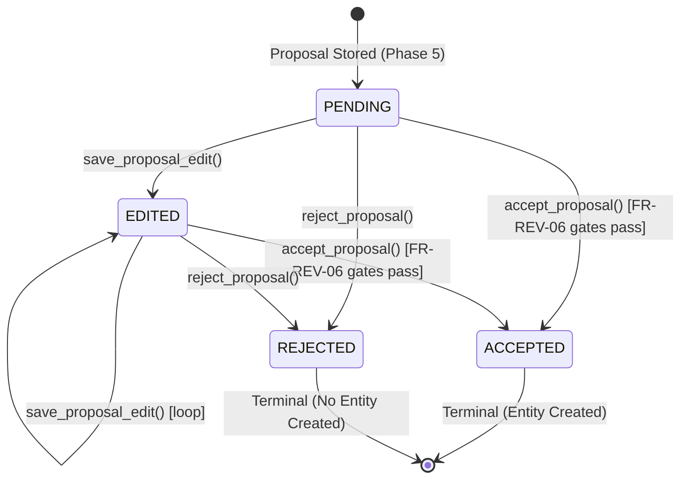

# ASEC Phase 6 Plan — Proposal Review Service

Status: plan only (no implementation). Derived from `docs/SRS.md` (requirements
authority), `AGENTS.md` (workflow, architecture and safety rules), `docs/ASEC_Context_Prompt.md`,
and the actual repository state at HEAD `7e0d77c` (verified 2026-10-25).
Storage existence never implies behavior is implemented; tests-first and the slice
workflow of `AGENTS.md` apply to every step below.

Produced as **one coordinated whole-phase plan** under the owner-directed
pattern used for Phases 3, 4, and 5 (single batch, consolidated verification pass),
with internal workstreams. Awaiting owner approval before any implementation.

---

## 1. Verified baseline (2026-10-25 check, read-only)

- Branch `main`; HEAD `7e0d77c` — "Phase 5 implemented :)".
  Phase 5 proposal generation, validation, and attempt input storage are **committed**;
  working tree clean; nothing staged.
- Full battery at this HEAD, freshly executed and observed (not merely claimed):
  - `.venv\Scripts\python.exe -m pytest`: **877 passed in 138.47s (0:02:18)** (0 failures, 0 errors, 0 skips);
  - `.venv\Scripts\python.exe -m ruff check .`: **All checks passed!**
  - `.venv\Scripts\python.exe -m mypy`: **Success: no issues found in 13 source files**;
  - `.venv\Scripts\python.exe -m backend --version`: **`0.0.1`**;
  - Fresh-database migration probe (`apply_migrations` on `:memory:`):
    - `first: [1, 2, 3, 4, 5, 6, 7, 8, 9, 10, 11, 12, 13, 14]`
    - `rerun: []` (idempotent)
    - `PRAGMA foreign_key_check`: `[]` (clean)
    - `PRAGMA integrity_check`: `['ok']` (clean);
  - `git diff --check`: clean (0 errors, no whitespace/newline anomalies);
  - `git status --short`: clean (only untracked `?? docs/PHASE6_PLAN.md` in workspace).
- Source of diagrams:
  - File `docs/SRS_figures_digest.md` **does not exist** in the repository. Per `AGENTS.md`,
    Figure 6 ("Proposal review states") is sourced from the authoritative SRS specification
    and summarized in `docs/ASEC_Context_Prompt.md` (§12 line 236: "Review service edges (Figure 6):
    pending → edited (loops) → accepted or rejected; accepted and rejected are terminal; accept
    blocked while an assignee is unresolved or flagged.").

---

## 2. Phase 6 authoritative scope (from `docs/SRS.md`)

Phase 6 implements the **proposal review service** and notification staging hook:

- **FR-REV-01**: Review states are `PENDING`, `EDITED`, `ACCEPTED`, and `REJECTED`.
  `EDITED` is not final (can loop back to `EDITED` through subsequent edits).
  Accepting an edited proposal creates an entity from the latest edited values.
- **FR-REV-02**: The reviewer of a proposal is the sender of its primary source message
  (`proposal.primary_message_id -> source_message.sender_person_id`). Only the reviewer
  (and Admin) can review it. The review service provides a presentation view containing:
  the proposal draft, its source message with context (sender, group, timestamp, replies),
  and the provenance of each value.
- **FR-REV-03**: The reviewer shall be able to edit editable fields: description,
  assignment mode (`EXPLICIT`, `OPEN`, `NONE`), assignees, people needed (specific count or
  unlimited), task type (`INTERNAL`, `CROSS_VERTICAL`), responsible vertical, affected verticals,
  and attributes. Each edit creates an immutable `proposal_revision` recording who changed what
  and when (`changed_fields`, `person_id`, `changed_at`). The original generated row in
  `proposal` stays unchanged. (Whether `ptype` is editable is owner decision OD-REV-4).
- **FR-REV-04**: Saving an edit shall not accept the proposal. Edit and accept are separate
  actions, although client flows may present them consecutively.
- **FR-REV-05**: Accepting shall create exactly one task or announcement. Two simultaneous
  accepts, or a repeated accept, shall produce exactly one entity (idempotent/concurrency-safe).
- **FR-REV-06**: Accepting shall be blocked while any proposed assignee is `UNRESOLVED` or
  `FLAGGED`, or a required field is unfilled. For an `OPEN` task, `people_needed` shall be a
  positive integer or `UNLIMITED`.
- **FR-REV-07**: Rejecting shall record a `proposal_decision` row (`decision = 'REJECTED'`,
  optional note, timestamp, actor) and transition `review_state` to `REJECTED`. The proposal,
  its revisions, and the rejection record are kept. A rejected proposal is never regenerated
  or reconsidered automatically.
- **FR-REV-08**: Rejected and edited proposals shall be usable as labelled evaluation data
  (queryable with full revision history and delta against generated drafts).
- **FR-REV-09**: For each proposal the system shall record which fields the reviewer changed
  (`proposal_revision.changed_fields`).
- **FR-REV-10**: An accepted `ANNOUNCEMENT` proposal shall create an announcement record
  targeted to its audience (a Head’s vertical, or the sender AH’s volunteers) and shall
  **not** create a task.
- **FR-PRP-17**: When a valid proposal is stored, the backend shall notify its reviewer,
  and no one else. (Review phase delivers the authoritative proposal-ready notification hook).
- **FR-AUT-01 / Matrix**: Proposal review/edit/accept/reject is authorized strictly for
  the primary message sender (AH/Head) or Admin override. Unauthorized calls fail loud and
  raise `ReviewAuthorizationError` before any state mutation.
- Acceptance criteria from SRS §10.2:
  - **AC-04**: Proposal rejection with optional note.
  - **AC-05**: Proposal edit creates immutable revision; proposal row values stay unchanged.
  - **AC-06**: Acceptance blocked while any assignee is unresolved or flagged.
  - **AC-07**: Acceptance of TASK creates task and records decision.
  - **AC-18**: Acceptance of ANNOUNCEMENT creates announcement record and no task.

### Explicit non-goals (standing boundaries; out of Phase 6):
1. **Task volunteer lifecycle (Phase 7)**: Volunteer task claiming (`FR-TSK-04`),
   agreement transitions (`AWAITING -> ACCEPTED / DENIED`, `FR-TSK-05`), volunteer work status
   transitions (`NOT_STARTED -> IN_PROGRESS -> COMPLETED`, `FR-TSK-06`), task cancellation
   (`FR-TSK-08`), and post-creation editing/reassignment (`FR-TSK-16`).
2. **Cross-vertical approval decision voting (Phase 8)**: Processing approval or denial decisions
   from target vertical AHs/Head (`FR-XV-04..06`). Phase 6 stages the request and initial state
   dimensions upon acceptance, but does not implement the approval voting service.
3. **External notification delivery transport (Phase 9)**: FCM push dispatch, SMS OTP,
   network transport, delivery worker loops (`FR-NOT-06..07`). Phase 6 writes notification rows
   in `0008` storage only.
4. **HTTP / REST / GraphQL API & Mobile App UI (Phase 10)**: FastAPIs, JWT authentication,
   and mobile screens (`FR-UI-*`). Phase 6 delivers pure Python backend services and domain functions.
5. **Direct Discord mutations**: Discord is read-only source; no Discord messages or bot posts.

---

## 3. Established storage and code to reuse (no rebuild)

Already migrated and available in SQLite:
- `0001_core_roster.sql`: `person` (active, role, `discord_user_id`), `vertical`, `person_vertical`.
- `0002_source_messages.sql`: `source_message` (`sender_person_id`, `event_timestamp`, content).
- `0003_buckets.sql`: `bucket`, `bucket_message`.
- `0004_processing_attempts.sql`: `processing_attempt`.
- `0005_proposals.sql`:
  - `proposal` table (`review_state` with CHECK `IN ('PENDING', 'EDITED', 'ACCEPTED', 'REJECTED')`,
    ptype, assignment_mode, people_needed, task_type, verticals, provenance).
  - `proposal_revision` table (`proposal_id`, `revision_number`, `person_id`, `changed_fields`,
    `changed_at`, snapshot content fields, `UNIQUE(proposal_id, revision_number)`).
  - `revision_attribute` table (`revision_id`, `attr_key`, `attr_value`).
  - `revision_affected_vertical` table (`revision_id`, `vertical_id`).
  - `proposal_context_message` table.
- `0006_tasks.sql`:
  - `task` table (`proposal_id UNIQUE`, `task_type`, `source_vertical_id`, `responsible_vertical_id`,
    `creator_id`, `description`, `assignment_mode`, `people_needed`, `people_needed_unlimited`,
    `approval_state`, `cancellation`, `version`, `created_at`).
  - `task_assignee` table (`task_id`, `person_id`, `agreement`, `agreed_at`, `work_status`,
    `cancelled`, `added_at`, `UNIQUE(task_id, person_id)`).
  - `task_history` table (`task_id`, `field_name`, `old_value`, `new_value`, `changed_at`,
    `actor_person_id`, `actor_role`, `actor_vertical_id`, `reason`).
  - `task_attribute` table (`task_id`, `attr_key`, `attr_value`, `UNIQUE(task_id, attr_key)`).
  - `task_affected_vertical` table (`task_id`, `vertical_id`, `UNIQUE(task_id, vertical_id)`).
- `0007_cross_vertical_approvals.sql`:
  - `approval_request` table (`task_id UNIQUE`, `requested_by`, `request_message`, `created_at`).
  - `approval_recipient` table (`request_id`, `person_id`, `UNIQUE(request_id, person_id)`).
  - `approval_decision` table (`request_id UNIQUE`).
- `0008_notifications.sql`: `notification` table (`dedupe_key UNIQUE`, `event_type`, `recipient_person_id`,
  `proposal_id`, `task_id`, `delivery_state`, `created_at`).
- `0009_announcements.sql`: `announcement` table (`proposal_id UNIQUE`, `accepted_by`, `accepted_at`,
  `audience_vertical_id`, `audience_scope`).
- `0012_resolution_and_mentions.sql`:
  - `proposal_decision` table (`proposal_id UNIQUE`, `decision IN ('ACCEPTED', 'REJECTED')`,
    `decided_by`, `decided_at`, `note`).
  - `proposal_assignee` table (`proposal_id`, `assignee_text`, `resolution IN ('RESOLVED', 'UNRESOLVED', 'FLAGGED')`,
    `person_id`, `resolved_via IN ('MENTION', 'NAME_MATCH')`).
  - `message_mention` table.
- `0014_proposal_attempt_input.sql`: `proposal_attempt_input`.

Existing backend modules to consume:
- `backend/db/connection.py`: `connect()`, `transaction(connection)` (`BEGIN IMMEDIATE`).
- `backend/proposals.py`: types, resolution routines, policy checks.
- `backend/masking.py`: PII masking.

---

## 4. Architecture and State Machine (Figure 6)

### 4.1 State Machine Specification



1. **PENDING**: Initial state upon generation by Phase 5 (`review_state = 'PENDING'`).
2. **EDITED**: Non-terminal state entered whenever an authorized user saves an edit.
   Can loop back to `EDITED` indefinitely as revisions increment (`1, 2, ...`).
3. **ACCEPTED**: Strictly terminal state.
   - Enforces FR-REV-06 validation gates.
   - Transitions `proposal.review_state` to `'ACCEPTED'`.
   - Inserts exactly one `proposal_decision` row (`decision = 'ACCEPTED'`).
   - Materializes the authoritative entity rows in `task` or `announcement`.
   - Subsequent or concurrent accepts are idempotent (return existing entity ID).
4. **REJECTED**: Strictly terminal state.
   - Transitions `proposal.review_state` to `'REJECTED'`.
   - Inserts exactly one `proposal_decision` row (`decision = 'REJECTED'`).
   - Writes no task or announcement.
   - Preserves all historical records for evaluation (FR-REV-07, FR-REV-08).

### 4.2 Authorization Rules

Every review operation (`get_proposal_review`, `save_proposal_edit`, `accept_proposal`, `reject_proposal`)
requires `actor_person_id: int`:

1. Look up actor in `person` table:
   - Must exist and have `active = 1`. Inactive persons are rejected immediately.
2. Admin recognition:
   - Evaluated using the same configurable, case-insensitive token approach as Phase 5:
     `DEFAULT_ADMIN_ROLE_TOKENS = ("Admin",)`. Config key `ADMIN_ROLES` allows comma-separated
     overrides. Actor's trimmed role matching this set (case-insensitive) confers Admin authority.
3. Reviewer check:
   - Look up `proposal` joined with `primary_message`:
     `reviewer_person_id = source_message.sender_person_id`.
   - If `actor_person_id == reviewer_person_id`: **Authorized (Reviewer)**.
   - If actor matches Admin role: **Authorized (Admin Override)**.
   - Otherwise: **Reject** with `ReviewAuthorizationError` (single consistent exception name).
4. Unauthorized attempts write no revision, decision, or entity.

### 4.3 Immutable Revisions (`proposal_revision`)

When saving an edit (`save_proposal_edit`):
- Transaction locks the database (`BEGIN IMMEDIATE`).
- Verify proposal is in an editable state (`PENDING` or `EDITED`). If `ACCEPTED` or `REJECTED`,
  fail with `TerminalStateError`.
- **Stale-edit mechanism**: caller provides `expected_revision_number: int | None`.
  - For the **first edit**, `expected_revision_number` must be `0` or `None`.
  - For subsequent edits, `expected_revision_number` must equal the latest `revision_number`.
  - If current latest revision != `expected_revision_number`: the edit is rejected, and the loser
    receives `StaleRevisionError` carrying the current latest revision content and number.
- Compute `changed_fields`: JSON list of field names whose post-edit values differ from the current effective draft.
- Increment `revision_number`: 1 if first edit, otherwise `max(revision_number) + 1`.
- Insert into `proposal_revision`:
  - `proposal_id`, `revision_number`, `person_id` (actor), `changed_fields` (JSON string), `changed_at` (ISO-8601 UTC).
  - Snapshot columns: `description`, `assignment_mode`, `proposed_assignees_text`, `people_needed`,
    `people_needed_unlimited`, `task_type`, `suggested_responsible_vertical_id`.
- Insert into `revision_attribute` and `revision_affected_vertical`.
- Update `proposal.review_state = 'EDITED'`.
- Save revision-keyed assignees (see §4.4).
- The original `proposal` row columns remain untouched.

### 4.4 Assignee Resolution on Edit & Revision-Keyed Storage

- **Problem in current schema**:
  `proposal_assignee` (`0012`) is keyed by `proposal_id` only, with CHECK
  `resolved_via IN ('MENTION', 'NAME_MATCH')`. Overwriting `proposal_assignee` rows on edit
  destroys the audit trail of the original generated resolution, violating FR-REV-03 ("original
  generated version stays unchanged") and DR-03/DR-07. Furthermore, when a reviewer directly
  selects a roster person, the `resolved_via` CHECK lacks a `MANUAL` token.
- **Solution & Migration 0015 (`0015_review_revisions.sql`)**:
  - Add `revision_assignee` table:
    ```sql
    CREATE TABLE revision_assignee (
        id            INTEGER PRIMARY KEY,
        revision_id   INTEGER NOT NULL,
        assignee_text TEXT NOT NULL,
        resolution    TEXT NOT NULL,
        person_id     INTEGER,
        resolved_via  TEXT,
        CHECK (resolution IN ('RESOLVED', 'UNRESOLVED', 'FLAGGED')),
        CHECK (resolved_via IS NULL OR resolved_via IN ('MENTION', 'NAME_MATCH', 'MANUAL')),
        CHECK (length(trim(assignee_text)) > 0),
        CHECK (
            (resolution = 'RESOLVED' AND person_id IS NOT NULL AND resolved_via IS NOT NULL)
            OR
            (resolution IN ('UNRESOLVED', 'FLAGGED') AND person_id IS NULL AND resolved_via IS NULL)
        ),
        FOREIGN KEY (revision_id) REFERENCES proposal_revision (id) ON DELETE RESTRICT,
        FOREIGN KEY (person_id) REFERENCES person (id) ON DELETE RESTRICT
    );
    ```
  - **Direct roster selection**: stored with `resolved_via = 'MANUAL'`, `resolution = 'RESOLVED'`,
    and `person_id` explicitly set.
  - **Name match scope (OD-REV-2)**:
    FR-PRP-10 states: "match the name against active roster names in the source vertical".
    Phase 5 pinned DC-6 restricted name matching to active members of the *source vertical*.
    On review edit, if responsible vertical is changed, whether matching expands to responsible
    vertical is owner decision OD-REV-2. By default, Phase 5's pinned behavior (source vertical)
    is preserved unless OD-REV-2 explicitly directs otherwise.
  - `proposal_assignee` stores the original generated proposal resolution; `revision_assignee`
    stores the resolution for each revision. The effective assignees at any time are those of the
    latest revision (or `proposal_assignee` if unedited).

### 4.5 Acceptance Gating (FR-REV-06)

Acceptance is strictly blocked unless **both** gating categories pass:

1. **Unresolved / Flagged Assignees Gate**:
   - For `EXPLICIT` mode: at least one proposed assignee must exist, and **every** proposed assignee
     in the effective draft must have `resolution = 'RESOLVED'` (`person_id NOT NULL`). If any assignee
     is `UNRESOLVED` or `FLAGGED`, raise `AcceptanceBlockedError("UNRESOLVED_ASSIGNEES", details=...)`.
   - For `OPEN` mode: proposed assignees must be empty.
   - For `NONE` mode (announcement): proposed assignees must be empty.
2. **Required Field Unfilled Gate**:
   - `description` is NULL or blank (length of trimmed string == 0).
   - `OPEN` mode task without a positive `people_needed` (`> 0`) or `people_needed_unlimited == 1`.
   - `EXPLICIT` mode task with no assignee.
   - `CROSS_VERTICAL` task with no responsible vertical (`responsible_vertical_id IS NULL`).
   *(Note: Phase 5 stores missing values as NULL per DC-16 and never produces bracket tokens like
   `[VENUE]`; gating strictly inspects NULL, blank text, and missing structural links).*

### 4.6 Exact Accept Transaction Execution & Cross-Vertical Workflows

All writes occur in **one atomic transaction** (`BEGIN IMMEDIATE`):

#### A. Accepting a TASK Proposal:
1. `proposal.review_state` is updated to `'ACCEPTED'`.
2. `proposal_decision` row is inserted:
   - `proposal_id`: proposal id (UNIQUE).
   - `decision`: `'ACCEPTED'`.
   - `decided_by`: actor person id.
   - `decided_at`: ISO UTC timestamp.
   - `note`: optional reviewer note.
3. Determine `creator_id`:
   - By default, creator is the accepting reviewer (`actor_person_id`).
   - If an Admin accepts on behalf of the reviewer, whether `creator_id` is set to the primary
     message sender (preserving task ownership per FR-TSK-01) or the Admin is owner decision OD-REV-6.
4. Determine Cross-Vertical / Approval State (FR-XV-02, FR-XV-03):
   - Check if task is `CROSS_VERTICAL` (`responsible_vertical_id != source_vertical_id`):
     - **If reviewer is an AH**:
       - `approval_state = 'PENDING'`. The task is created hidden and never visible to volunteers
         before approval (FR-XV-03).
       - Create `approval_request` row: `task_id`, `requested_by = actor_person_id`, `request_message`, `created_at`.
       - Create `approval_recipient` rows: snapshot of every AH and Head of the responsible vertical (0007).
     - **If reviewer is a Head**:
       - `approval_state = 'NOT_REQUIRED'`. Task goes live immediately (FR-XV-02).
       - Notification hook stages a `HEAD_CROSS_VERTICAL_TASK` notification for the responsible Head.
     - **If task is INTERNAL**:
       - `approval_state = 'NOT_REQUIRED'`.
5. Insert `task` row:
   - `proposal_id`: proposal id.
   - `task_type`: `'INTERNAL'` or `'CROSS_VERTICAL'`.
   - `source_vertical_id`: proposal's source vertical.
   - `responsible_vertical_id`: proposal/revision responsible vertical.
   - `creator_id`: creator person id.
   - `description`: effective description.
   - `assignment_mode`: `'EXPLICIT'` or `'OPEN'`.
   - `people_needed` & `people_needed_unlimited`: effective headcount.
     *(For EXPLICIT tasks, migration 0006 forces `people_needed = 1` and `people_needed_unlimited = 0`;
     for a multi-person explicit task, 0006 stores `people_needed = 1` while all assignees are
     inserted in `task_assignee`, pending PB-3 schema rebuild).*
   - `approval_state`: `'PENDING'` or `'NOT_REQUIRED'`.
   - `cancellation`: `'ACTIVE'`.
   - `version`: `1`.
   - `created_at`: ISO UTC timestamp.
6. Insert `task_assignee` rows (for EXPLICIT tasks):
   - One row per resolved assignee:
     `task_id`, `person_id`, `agreement = 'AWAITING'`, `agreed_at = NULL`, `work_status = 'NOT_STARTED'`,
     `cancelled = 0`, `added_at`.
7. Insert `task_history` creation row:
   - `task_id`: task id.
   - `field_name`: `'TASK_CREATED'`.
   - `old_value`: NULL, `new_value`: `'ACTIVE'`.
   - `changed_at`: timestamp.
   - `actor_person_id`: actor person id.
   - `actor_role`: actor's active roster role (e.g. `'AH'`, `'Head'`, `'Admin'`).
   - `actor_vertical_id`: actor's vertical id.
   - `reason`: `'PROPOSAL_ACCEPTED'`.
8. Insert `task_attribute` rows (one per effective attribute).
9. Insert `task_affected_vertical` rows (one per effective affected vertical).

#### B. Accepting an ANNOUNCEMENT Proposal:
1. `proposal.review_state` is updated to `'ACCEPTED'`.
2. `proposal_decision` row is inserted (`decision = 'ACCEPTED'`).
3. Insert `announcement` row (0009):
   - `proposal_id`: proposal id.
   - `accepted_by`: actor person id.
   - `accepted_at`: timestamp.
   - `audience_vertical_id`: vertical id (or NULL).
   - `audience_scope`: scope string per OD-REV-5.
4. Zero rows written to `task`, `task_assignee`, or `task_history` (FR-REV-10).

#### C. Repeated or Simultaneous Accept:
- If a proposal is already `ACCEPTED`: the transaction immediately returns the existing `task.id`
  or `announcement.id` without creating duplicates (idempotent success).

### 4.7 Notification Hooks (FR-PRP-17)

- **Requirement**: "When a valid proposal is stored, the backend shall notify its reviewer, and no one else."
- **Execution pattern**:
  - Proposal generation in Phase 5 did not write notification rows.
  - Review service provides:
    1. `notify_proposal_ready(connection, proposal_id)`: callable immediately following proposal storage.
    2. `sweep_unnotified_proposals(connection)`: idempotent recovery sweep finding all valid proposals
       that lack a `PROPOSAL_READY:{proposal_id}` entry in `notification`.
  - Notification row composition:
    - `event_type`: `'PROPOSAL_READY'`.
    - `recipient_person_id`: `source_message.sender_person_id`.
    - `dedupe_key`: `'PROPOSAL_READY:{proposal_id}'` (UNIQUE constraint in 0008 prevents duplicate insertion).
    - `proposal_id`: proposal id.
    - `delivery_state`: `'PENDING'`.
    - `created_at`: timestamp.
  - No network delivery, push dispatch, or worker threads are started in Phase 6 (Phase 9 non-goal).

---

## 5. Phase 6 / Phase 7 Boundary Analysis

### Problem Statement
**FR-REV-05** requires: *"Accepting shall create exactly one task or announcement."*
Task execution lifecycle is Phase 7 (`FR-TSK-*`). The plan must clearly delineate the boundary.

### Options Evaluated

| Option | Description | Trade-offs |
|---|---|---|
| **Option A (Recommended)** | **Authoritative Entity Materialization in Phase 6**: The accept transaction writes `proposal.review_state = 'ACCEPTED'`, `proposal_decision`, and materializes the accepted entity: (1) for `TASK`: the single `task` row (0006) with initial dimensions (`approval_state`, `cancellation = 'ACTIVE'`, `version = 1`), initial `task_assignee` rows (`AWAITING`), `task_history` creation log, attributes, and affected verticals; (2) for `ANNOUNCEMENT`: the single `announcement` row (0009). Phase 7 then implements post-creation volunteer lifecycle (claims, agreements, status changes, completions). | **Cleanest & Authoritative**: Fulfills FR-REV-05 verbatim, satisfies `UNIQUE(proposal_id)` in 0006/0009, eliminates illegal orphan states (`ACCEPTED` proposal with no task), and respects database integrity. |
| **Option B** | **Pluggable Protocol Hook**: Phase 6 accept transaction invokes a `TaskCreator` protocol. Concrete implementation is provided only in tests or downstream. | **Unstable Boundary**: Leaves Phase 6 incomplete without a bound implementation; risks orphan accepted proposals in production database. |
| **Option C** | **Deferred Entity Creation**: Phase 6 writes `proposal_decision` only; task row is created only when Phase 7 runs. | **Violates FR-REV-05**: Direct violation of SRS mandatory text and breaks database foreign keys. |

**Recommendation**: Adopt **Option A**. Phase 6 materializes the accepted `task` and `announcement` rows inside the accept transaction.

---

## 6. Expected File Changes

| Path | Change Type | Purpose |
|---|---|---|
| `backend/review.py` | **New** | Review domain service: `get_proposal_review()`, `save_proposal_edit()`, `accept_proposal()`, `reject_proposal()`, `notify_proposal_ready()`, `sweep_unnotified_proposals()`, authorization, acceptance gating, and materialization. |
| `backend/db/migrations/0015_review_revisions.sql` | **New** | Additive migration for `revision_assignee` table to preserve per-revision resolution history with `MANUAL` support. |
| `tests/test_review_service.py` | **New (~85 tests)** | Comprehensive test suite covering FR-REV-01..10, FR-PRP-17, Figure 6 transitions, authorization, concurrency, and acceptance scenarios AC-04..07, AC-18. |
| `tests/test_migrations_resolution.py` | **Modify** | Increment expected migration count assertion from 14 to 15 (`range(1, 16)`). |
| `docs/PHASE6_PLAN.md` | **New** | This whole-phase plan document. |

---

## 7. Requirement Traceability Matrix (Phase 6)

| Requirement | Description | Phase 6 Implementation | Tests |
|---|---|---|---|
| **FR-REV-01** | Review states (PENDING, EDITED, ACCEPTED, REJECTED) | State machine enum and transitions in `backend/review.py` | `test_review_state_transitions_figure_6` |
| **FR-REV-02** | Reviewer identity (sender) & Admin override; presentation view | `_verify_reviewer_auth()`, `get_proposal_review()` view model | `test_reviewer_authorization`, `test_admin_override`, `test_review_presentation_view` |
| **FR-REV-03** | Editable fields, immutable revisions, generated row unchanged | `save_proposal_edit()`, `proposal_revision` row insertion | `test_edit_creates_immutable_revision`, `test_original_proposal_row_unchanged` |
| **FR-REV-04** | Edit does not accept | `save_proposal_edit()` sets `review_state = 'EDITED'`, writes no decision | `test_edit_does_not_accept` |
| **FR-REV-05** | Single task/announcement on accept; idempotent/concurrency-safe | `accept_proposal()`, transaction lock, `proposal_decision` write | `test_accept_creates_single_task`, `test_concurrent_accept_is_idempotent` |
| **FR-REV-06** | Block accept on unresolved/flagged assignees or unfilled required fields | `_validate_acceptance_gates()` checking assignees and required fields | `test_accept_blocked_unresolved_assignee`, `test_accept_blocked_open_task_no_count` |
| **FR-REV-07** | Rejection keeps proposal, revisions, and decision; never reconsidered | `reject_proposal()`, `proposal_decision` write with optional note | `test_reject_proposal_keeps_history`, `test_rejected_proposal_cannot_be_reopened` |
| **FR-REV-08** | Usable as evaluation data | `list_reviewed_proposals_for_eval()` query function | `test_evaluation_data_export` |
| **FR-REV-09** | Record changed fields | `changed_fields` JSON column on `proposal_revision` | `test_changed_fields_recorded` |
| **FR-REV-10** | Accepted announcement creates announcement, no task | `accept_proposal()` branch for `ptype == 'ANNOUNCEMENT'` | `test_accept_announcement_creates_no_task` |
| **FR-PRP-17** | Notify reviewer on valid proposal storage | `notify_proposal_ready()` & sweep staging `notification` rows | `test_notify_proposal_ready_hook`, `test_sweep_unnotified_proposals` |
| **AC-04** | Acceptance scenario: Rejection with note | Scenario test matching SRS §10.2 | `test_ac04_proposal_rejection` |
| **AC-05** | Acceptance scenario: Edit creates revision | Scenario test matching SRS §10.2 | `test_ac05_proposal_edit_revision` |
| **AC-06** | Acceptance scenario: Accept blocked on unresolved | Scenario test matching SRS §10.2 | `test_ac06_accept_blocked_on_unresolved` |
| **AC-07** | Acceptance scenario: Accept TASK creates task | Scenario test matching SRS §10.2 | `test_ac07_accept_task_creates_task` |
| **AC-18** | Acceptance scenario: Announcement acceptance | Scenario test matching SRS §10.2 | `test_ac18_accept_announcement` |

---

## 8. Test Strategy & Acceptance Criteria (Tests-First)

All implementation will follow `AGENTS.md` test-first discipline:
1. **Unit tests for State Transitions (Figure 6)**:
   - `PENDING -> EDITED`, `EDITED -> EDITED` (looping).
   - `PENDING -> ACCEPTED`, `EDITED -> ACCEPTED`.
   - `PENDING -> REJECTED`, `EDITED -> REJECTED`.
   - Illegal transitions: `ACCEPTED -> EDITED`, `REJECTED -> EDITED`, `ACCEPTED -> REJECTED`,
     `REJECTED -> ACCEPTED`.
2. **Authorization Unit tests**:
   - Primary message sender AH reviews: Allowed.
   - Colleague AH in same vertical reviews: Blocked (`ReviewAuthorizationError`).
   - Volunteer reviews: Blocked (`ReviewAuthorizationError`).
   - Admin reviews: Allowed (Admin Override recorded).
   - Inactive user reviews: Blocked.
3. **Revision Snapshot tests**:
   - Edit description: `changed_fields = ["description"]`, original proposal row unchanged.
   - Direct roster selection stored in `revision_assignee` with `resolved_via = 'MANUAL'`.
   - Monotonic revision numbers: 1, 2, 3...
   - Stale edit attempt (mismatched `expected_revision_number`) raises `StaleRevisionError` with latest content.
4. **Acceptance Gating tests**:
   - `UNRESOLVED` or `FLAGGED` assignee blocks accept.
   - NULL or blank description blocks accept.
   - `OPEN` task with NULL people needed blocks accept.
   - `CROSS_VERTICAL` task with NULL responsible vertical blocks accept.
   - Resolving assignee allows subsequent accept.
5. **Decision & Entity Creation tests**:
   - Accepting `TASK` creates exactly one `task` row, `task_assignee` rows, `task_history` row,
     and `proposal_decision` row.
   - AH-raised cross-vertical task creates `task` with `approval_state = 'PENDING'`, `approval_request`,
     and `approval_recipient` rows.
   - Head-raised cross-vertical task creates `task` with `approval_state = 'NOT_REQUIRED'`.
   - Accepting `ANNOUNCEMENT` creates exactly one `announcement` row, zero `task` rows.
   - Simultaneous accept produces exactly one entity.
6. **Notification Hook tests**:
   - `notify_proposal_ready()` creates deduplicated `notification` row (`event_type = 'PROPOSAL_READY'`).
   - `sweep_unnotified_proposals()` recovers missed notifications idempotently.

---

## 9. Workstreams (Execution Plan)

- **WS-1: Migration 0015 & Schema Updates**
  - Create `0015_review_revisions.sql` with `revision_assignee` (`MANUAL` support).
  - Update `test_migrations_resolution.py` migration count.
- **WS-2: Domain Model & State Machine**
  - Implement review state machine, exception hierarchy (`ReviewError`, `ReviewAuthorizationError`,
    `AcceptanceBlockedError`, `StaleRevisionError`), and data contracts.
- **WS-3: Authorization & Presentation View**
  - Implement reviewer derivation (`primary_message.sender_person_id`), Admin override verification,
    and presentation context compilation (source message, bucket context, field provenance).
- **WS-4: Edit Pipeline & Revision Immutability**
  - Implement `save_proposal_edit()`, delta computation (`changed_fields`), revision number management,
    attribute/vertical snapshotting, and `revision_assignee` writing.
- **WS-5: Acceptance Gating & Decision Storage**
  - Implement `_validate_acceptance_gates()`, `reject_proposal()`, `accept_proposal()`,
    `proposal_decision` persistence, and task/announcement materialization.
- **WS-6: Cross-Vertical Task Handling & Notifications**
  - Implement AH cross-vertical staging (`approval_state = 'PENDING'`, `approval_request`, `approval_recipient`),
    Head cross-vertical handling (`NOT_REQUIRED`), and `notify_proposal_ready()` hook.
- **WS-7: Full E2E Acceptance Verification & Battery**
  - Run all acceptance scenario tests AC-04, AC-05, AC-06, AC-07, AC-18, and full repository verification battery.

---

## 10. Security, Privacy, and Provenance

- **Server-Side Authorization**: UI visibility does not grant authority. Every service function
  authenticates the caller against the database.
- **PII Protection**: Presentation view masks phone numbers and emails for context messages
  in accordance with viewer hierarchy (NFR-SEC-03 / NFR-SEC-04).
- **Audit Immutability (DR-03, DR-07)**: Neither edits nor decisions overwrite source messages,
  generation attempts, or original proposal drafts. `proposal_revision`, `revision_assignee`,
  and `proposal_decision` are strictly append-only.

---

## 11. Owner Decision Gates (Marked for Owner Direction)

- **OD-REV-1: Phase 6 / Phase 7 Entity Materialization Boundary (FR-REV-05)**:
  - *Option A (Recommended)*: Phase 6 accept transaction directly inserts the initial `task` (`0006`)
    and `announcement` (`0009`) rows, completing FR-REV-05.
  - *Option B*: Phase 6 delegates entity creation to a pluggable protocol interface.
  - *Option C*: Phase 6 writes `proposal_decision` only; entity creation deferred to Phase 7.
  - *Recommendation*: **Option A**, ensuring database integrity and immediate adherence to `UNIQUE(proposal_id)`.
- **OD-REV-2: Name Resolution Vertical Scope on Edit (FR-REV-03, FR-REV-06, FR-PRP-10)**:
  - FR-PRP-10 specifies: "match the name against active roster names in the source vertical".
  - Phase 5 pinned DC-6 restricted name matching to active members of the *source vertical*.
  - If a reviewer edits the *responsible vertical*, should assignee names resolve against the
    source vertical or the new responsible vertical?
  - *Recommendation*: Preserve Phase 5 DC-6 (source vertical) unless the owner approves expanding
    resolution to responsible vertical (which requires amending DC-6 tests).
- **OD-REV-3: Storage for Per-Revision Assignees (FR-REV-03, DR-03)**:
  - `0005` snapshots text in `proposal_revision.proposed_assignees_text`, but structured resolution
    is in `proposal_assignee` (keyed by `proposal_id`). Overwriting `proposal_assignee` destroys
    the generated resolution history.
  - *Option A (Recommended)*: Introduce migration `0015_review_revisions.sql` with table `revision_assignee`
    supporting `resolved_via IN ('MENTION', 'NAME_MATCH', 'MANUAL')`.
  - *Option B*: Retain only textual assignees in `proposal_revision` and evaluate resolution dynamically
    without storing structured revision rows.
  - *Recommendation*: **Option A** to preserve full audit fidelity and allow direct roster selection.
- **OD-REV-4: Proposal Type Mutability (`ptype`) (FR-REV-03)**:
  - Can a reviewer convert a `TASK` to an `ANNOUNCEMENT` during review?
  - FR-REV-03 states: *"The reviewer shall be able to edit any field: description, assignment mode,
    assignees, people needed, task type (same vertical or cross-vertical), responsible vertical,
    affected verticals, and attributes."*
  - The sentence begins with "edit any field" but specifically enumerates fields, omitting `ptype`.
    `0005` has no `ptype` column in `proposal_revision`.
  - *Recommendation*: `ptype` is **immutable** during review (fixed by model generation).
- **OD-REV-5: Announcement Audience Scope Structure (FR-REV-10, PB-6)**:
  - FR-REV-10 states an accepted announcement is shown to "a Head's vertical, or the sender AH's volunteers".
    In `0009_announcements.sql`, audience is stored as `audience_vertical_id INTEGER` and `audience_scope TEXT`.
  - How should "sender AH's volunteers" be stored?
  - *Option A (Recommended)*: `audience_vertical_id = source_vertical_id`, `audience_scope = 'VOLUNTEERS'`.
  - *Option B*: `audience_vertical_id = NULL`, `audience_scope = 'AH_REPORTS:{ah_person_id}'`.
  - *Recommendation*: **Option A** for MVP simplicity, pending full PB-6 audience restructuring.
- **OD-REV-6: Task Creator on Admin Accept Override (FR-TSK-01)**:
  - FR-TSK-01 states: *"The creator is the reviewer who accepted the proposal."*
  - When an Admin accepts a proposal on behalf of the reviewer, who is `task.creator_id`?
  - *Option A (Recommended)*: `creator_id = primary_message.sender_person_id` (the reviewer),
    while `task_history` and `proposal_decision` record Admin as the actor.
  - *Option B*: `creator_id = admin_person_id`.
  - *Recommendation*: **Option A** so task ownership belongs to the vertical AH/Head.
- **OD-REV-7: Staging Approval Records in Phase 6 vs Phase 8 (FR-XV-03)**:
  - For an AH-raised cross-vertical task, should the accept transaction in Phase 6 insert `approval_request`
    and `approval_recipient` (0007), or leave them to Phase 8?
  - *Recommendation*: Insert them in Phase 6 so the task is properly staged with its recipient snapshot.

---

## 12. SRS Ambiguities and Requirement Notes

- **AMB-REV-01 (FR-REV-02 vs §4.9 Table)**:
  - FR-REV-02 states: *"Only the reviewer (and Admin) can review it."*
  - Table in §4.9 states for Head: *"Receive/review/edit/accept/reject proposals: Own"*.
  - Clarification: Does "Own" mean proposals created from the Head's own messages, or any proposal
    within the Head's vertical? Following FR-REV-02, review authority is strictly primary message sender
    + Admin override.
- **AMB-REV-02 (FR-TSK-01 vs 0006 `people_needed` for EXPLICIT)**:
  - Migration 0006 enforces `people_needed = 1` for all `EXPLICIT` tasks, while FR-TSK-01/03 allow
    several named people (PB-3). Plan notes dependency on PB-3.
- **AMB-REV-03 (FR-REV-05 / FR-REV-07 Double-Decisions)**:
  - Confirmed with Figure 6 that `ACCEPTED` and `REJECTED` are strictly terminal; double-accept is
    idempotent and transitions out of terminal states are disallowed.

---

## 13. Appendix: Verbatim Requirements from `docs/SRS.md`

Below are verbatim excerpts from `docs/SRS.md` governing the review service:

### Proposal Review (Section 3.5)
- **FR-REV-01**: Review states are PENDING, EDITED, ACCEPTED and REJECTED. EDITED is not final. Accepting an edited proposal creates a task from the edited values.
- **FR-REV-02**: The reviewer of a proposal is the sender of its primary source message. Only the reviewer (and Admin) can review it. The review screen shows the proposal, its source message with context (sender, group, time, replies), and the provenance of each value.
- **FR-REV-03**: The reviewer shall be able to edit any field: description, assignment mode, assignees, people needed, task type (same vertical or cross-vertical), responsible vertical, affected verticals, and attributes. Each edit creates a revision recording who changed what and when. The original generated version stays unchanged.
- **FR-REV-04**: Saving an edit shall not accept the proposal. Edit and accept are separate actions, although the app may present them as one flow.
- **FR-REV-05**: Accepting shall create exactly one task or announcement. Two simultaneous accepts, or a repeated accept, shall produce one.
- **FR-REV-06**: Accepting shall be blocked while any assignee is unresolved or flagged, or a required placeholder is unfilled. For an OPEN task the people needed shall be a positive number or UNLIMITED.
- **FR-REV-07**: Rejecting shall keep the proposal, its revisions and the rejection record. A rejected proposal is never regenerated or reconsidered automatically.
- **FR-REV-08**: Rejected and edited proposals shall be usable as labelled data for model evaluation.
- **FR-REV-09**: For each proposal the system shall record which fields the reviewer changed.
- **FR-REV-10**: An accepted ANNOUNCEMENT shall be shown to its audience (a Head’s vertical, or the sender AH’s volunteers) and shall not create a task.

### Proposal Notifications (Section 3.4)
- **FR-PRP-17**: When a valid proposal is stored, the backend shall notify its reviewer, and no one else.

### Tasks (Section 3.6)
- **FR-TSK-01**: A task shall have: persistent ID, description, task type, source vertical, responsible vertical, affected verticals, creator, assignment mode, people needed (open tasks), assignee records, and attributes. The creator is the reviewer who accepted the proposal. These are separate fields and are not assumed to be the same person or vertical.
- **FR-TSK-03**: Creating an EXPLICIT task shall create one assignee record per named person, each AWAITING. It shall not be ACCEPTED.
- **FR-TSK-11**: Every change to a task shall create an append-only history record: field, old value, new value, actor (user, or model with version), time, reason or evidence, and the actor’s role and vertical at that time. A changed value shall not overwrite history.

### Cross-Vertical Tasks (Section 3.7)
- **FR-XV-01**: A task is CROSS_VERTICAL when its responsible vertical differs from its source vertical. The reviewer sets this during review (FR-REV-03).
- **FR-XV-02**: A Head’s cross-vertical task goes live as soon as it is accepted. The Head of the responsible vertical shall be notified.
- **FR-XV-03**: An AH’s cross-vertical task, when accepted, shall be created with Approval = PENDING and shall not be visible to volunteers. A request, with an optional message from the requester, shall be sent to every AH and the Head of the responsible vertical.
